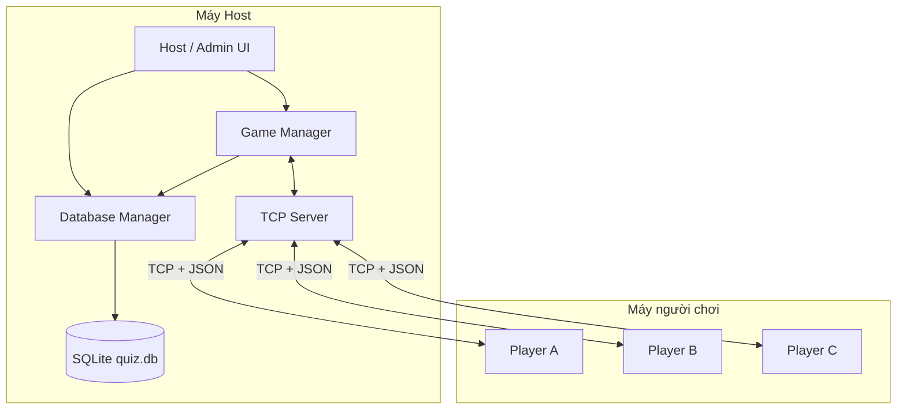
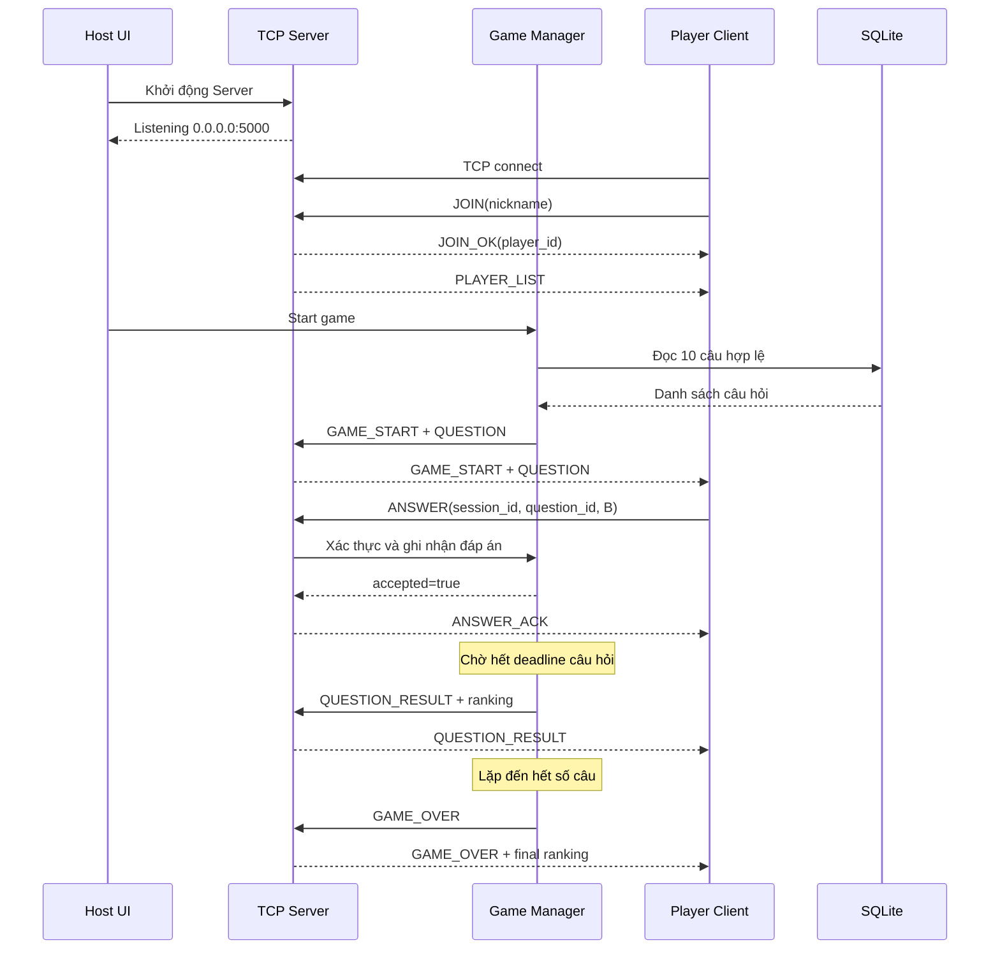

# ĐẶC TẢ KIẾN TRÚC VÀ THIẾT KẾ HỆ THỐNG NETWORK QUIZ BATTLE

> **Phiên bản tài liệu:** 2.0 — Bản đặc tả chi tiết để triển khai đồ án  
> **Đề tài:** Network Quiz Battle — Hệ thống thi trắc nghiệm nhiều người trong mạng LAN theo mô hình Client–Server  
> **Hình thức sản phẩm:** Phần mềm desktop  
> **Đối tượng:** Nhóm 03 sinh viên nhập môn Lập trình mạng máy tính  
> **Công nghệ định hướng:** Python, TCP Socket, `threading`, JSON, SQLite, Tkinter/CustomTkinter  
> **Phạm vi:** Sản phẩm MVP chạy được thật, phục vụ học tập và trình diễn trong LAN  
> **Trạng thái:** *Tài liệu thiết kế đề xuất, không phải mô tả một sản phẩm đã lập trình hoàn tất.*

---

## Mục lục

1. Giới thiệu, bài toán và mục tiêu
2. Đối tượng sử dụng và phạm vi dự án
3. Kiến trúc tổng thể
4. Kiến trúc triển khai trên các máy tính
5. Đặc tả các phân hệ
6. Yêu cầu chức năng và quy tắc nghiệp vụ
7. Thiết kế TCP Socket và máy chủ nhiều Client
8. Thiết kế giao thức thông điệp JSON
9. Quy trình hoạt động từ lúc khởi động đến kết thúc ván
10. Quản lý trạng thái, đồng bộ và thời gian
11. Quản lý người chơi, chấm điểm và bảng xếp hạng
12. Thiết kế SQLite và chức năng CRUD câu hỏi
13. Đặc tả giao diện Host và Player
14. Tổ chức mã nguồn và hợp đồng giữa các module
15. Xử lý đa luồng và cập nhật giao diện an toàn
16. Xử lý lỗi, ngắt kết nối và các tình huống ngoại lệ
17. Yêu cầu phi chức năng và giới hạn bảo mật
18. Kế hoạch kiểm thử chi tiết
19. Phân công công việc nhóm 3 người
20. Tiến độ phát triển trong 5 tuần
21. Kịch bản demo và tiêu chí nghiệm thu
22. Thứ tự kiến thức cần học cho người mới
23. Những phần không làm trong MVP và hướng mở rộng
24. Phụ lục ví dụ thông điệp, thuật ngữ và checklist

---

# 1. Giới thiệu, bài toán và mục tiêu

## 1.1. Bối cảnh

Các trò chơi trắc nghiệm trực tuyến thường sử dụng trình duyệt web và máy chủ trên Internet. Tuy nhiên, trong môn **Lập trình mạng máy tính**, mục tiêu quan trọng là hiểu cách hai hay nhiều chương trình tự thiết lập kết nối, trao đổi dữ liệu qua giao thức mạng và xử lý nhiều người dùng đồng thời.

Nhóm đề xuất xây dựng một trò chơi trắc nghiệm nhiều người dùng chạy trên **các máy tính cùng một mạng LAN hoặc Wi-Fi**. Một máy giữ vai trò Host/Server, các máy còn lại chạy ứng dụng Player/Client. Host quản lý ngân hàng câu hỏi và tổ chức ván thi; Player tham gia, nhận câu hỏi, trả lời trong thời gian giới hạn và xem điểm.

Đề tài khác với phần mềm trắc nghiệm thông thường ở chỗ dữ liệu **không chỉ được xử lý cục bộ**: câu hỏi phải được phát qua mạng, đáp án phải được gửi về máy chủ và kết quả phải được đồng bộ tới nhiều máy.

## 1.2. Phát biểu bài toán

Xây dựng một hệ thống đáp ứng được các câu hỏi sau:

- Làm sao để một Server duy trì kết nối với nhiều máy Client cùng lúc?
- Làm sao để các Client đều nhận cùng câu hỏi mà không cần truy cập trực tiếp cơ sở dữ liệu?
- Làm sao Server biết một câu trả lời thuộc về người chơi nào, câu số mấy, ván thi nào?
- Làm sao ngăn việc một người chơi gửi lại đáp án nhiều lần hoặc trả lời khi hết giờ?
- Làm sao mọi Player nhận được bảng điểm nhất quán?
- Làm sao Host thêm/sửa/xóa câu hỏi để phục vụ nhiều ván thi khác nhau?
- Làm sao một máy Player mất kết nối nhưng Server và các máy còn lại vẫn chạy?

## 1.3. Mục tiêu học phần

| Mã | Kiến thức/kỹ năng | Minh chứng trong sản phẩm |
|---|---|---|
| K01 | Client–Server | Một Host phục vụ nhiều Player |
| K02 | TCP Socket | Tự viết Server `bind/listen/accept`, Client `connect`, gửi/nhận dữ liệu |
| K03 | Multi-client | Các Client kết nối và trả lời đồng thời |
| K04 | Message Protocol | Tự quy ước `JOIN`, `QUESTION`, `ANSWER`, `RESULT`... |
| K05 | Đồng bộ trạng thái | Server quyết định câu hỏi, trạng thái và bảng điểm |
| K06 | Timeout | Server tự khóa đáp án sau khi hết thời gian |
| K07 | Lưu trữ cục bộ | SQLite quản lý câu hỏi, CRUD từ Host |
| K08 | Kiểm thử mạng | Demo trên nhiều máy trong cùng LAN và tình huống mất kết nối |

## 1.4. Mục tiêu sản phẩm

Kết thúc đồ án, nhóm cần bàn giao **hai ứng dụng desktop** (có thể khởi chạy từ mã nguồn):

1. **Host App:** tạo và quản lý ngân hàng câu hỏi, mở Server, quan sát phòng chờ, bắt đầu và theo dõi ván thi.
2. **Player App:** nhập IP/Port/nickname để kết nối, tham gia phòng, trả lời câu hỏi và xem kết quả.

Ngoài ra có mã nguồn, file SQLite hoặc script khởi tạo, dữ liệu câu hỏi mẫu, hướng dẫn chạy và tài liệu kiểm thử.

**Mục tiêu cốt lõi:** mô phỏng được một ván thi thực tế từ đầu đến cuối với tối thiểu **03 Client kết nối thành công**, không nhất thiết phải là ba máy vật lý khác nhau trong giai đoạn phát triển (nhưng nên demo trên nhiều máy nếu có thể).

---

# 2. Đối tượng sử dụng và phạm vi dự án

## 2.1. Vai trò Host/Admin

Host là người vận hành trên **máy Server**. Host không bắt buộc tham gia trả lời câu hỏi.

Các thao tác chính:

1. Mở ứng dụng Host.
2. Khởi tạo/kiểm tra địa chỉ IP và cổng Server.
3. Mở màn hình quản lý ngân hàng câu hỏi.
4. Thêm câu hỏi, xem danh sách, sửa câu hỏi, xóa/ẩn câu hỏi.
5. Xem người chơi đang có mặt trong phòng chờ.
6. Điều chỉnh các thông số đơn giản: số câu hỏi, thời lượng mỗi câu.
7. Nhấn **Bắt đầu**, quan sát tiến độ và kết quả.
8. Sau ván thi, kết thúc hoặc đưa phòng trở về trạng thái chờ để tổ chức ván mới.

**Quyền hạn:** Host được truy cập trực tiếp SQLite trên máy Server; Player không được thực hiện tác vụ quản trị từ xa.

## 2.2. Vai trò Player/Client

Các thao tác chính:

1. Mở ứng dụng Player.
2. Nhập IP và cổng của Server; nhập nickname.
3. Nhấn Kết nối; nếu hợp lệ, chuyển tới Lobby.
4. Xem danh sách người chơi trong phòng.
5. Chờ Host bắt đầu.
6. Đọc câu hỏi và chọn một trong A/B/C/D.
7. Gửi đáp án trước thời hạn.
8. Nhận xác nhận đã ghi nhận đáp án; chờ công bố kết quả.
9. Xem đáp án đúng, điểm số và xếp hạng; tiếp tục câu kế tiếp.
10. Xem bảng xếp hạng cuối ván.

**Giới hạn:** Player không tự cộng điểm, không quyết định hết giờ, không xem trước đáp án đúng và không trực tiếp truy cập `quiz.db`.

## 2.3. Ranh giới MVP

**Bao gồm:** 1 phòng thi, 1 Host, nhiều Player, bộ câu hỏi trắc nghiệm bốn lựa chọn, quản lý câu hỏi CRUD, đồng hồ đếm ngược, chấm điểm, bảng xếp hạng và xử lý ngắt kết nối cơ bản.

**Không bao gồm ở phiên bản đầu:** đăng ký tài khoản, nhiều phòng đồng thời, thi đấu Internet, chế độ mobile/web, trò chuyện âm thanh, chống gian lận nâng cao, khôi phục phiên chơi sau mất mạng, đăng nhập quản trị từ xa, thanh toán hoặc dịch vụ Cloud.

---

# 3. Kiến trúc tổng thể

## 3.1. Kiểu kiến trúc

Chọn **Centralized Client–Server** (Client–Server tập trung) vì nhóm mới nhập môn và cần một nguồn trạng thái thống nhất. Đây không phải kiến trúc Peer-to-Peer.

```text
                             MÁY HOST / SERVER
┌───────────────────────────────────────────────────────────────┐
│  HOST ADMIN UI                                                │
│  - Start/Stop Server       - Quản lý câu hỏi (CRUD)            │
│  - Người tham gia         - Điều khiển trò chơi               │
├───────────────────────────────────────────────────────────────┤
│  QUIZ GAME MANAGER                                            │
│  - Trạng thái ván          - Chọn và phát câu hỏi              │
│  - Deadline câu hỏi        - Nhận đáp án / kiểm tra hợp lệ     │
│  - Tính điểm               - Xếp hạng                         │
├───────────────────────────────────────────────────────────────┤
│  TCP SERVER                                                   │
│  - Listening socket       - Danh sách kết nối                 │
│  - Client Handler threads - JSON protocol                    │
│  - Gửi thông điệp cho nhiều Client                            │
├───────────────────────────────────────────────────────────────┤
│  DATABASE MANAGER                      SQLite (quiz.db)        │
│  - Tạo bảng, đọc câu hỏi, thêm/sửa/xóa                         │
└──────────────────────────┬────────────────────────────────────┘
                           │  TCP Socket + JSON UTF-8
                  ┌────────┼──────────┐
                  │        │          │
          ┌───────▼───┐ ┌──▼────────┐ ┌▼───────────┐
          │ Player A  │ │ Player B  │ │ Player C   │
          │ Client UI │ │ Client UI │ │ Client UI  │
          │ TCP Client│ │ TCP Client│ │ TCP Client │
          └───────────┘ └───────────┘ └────────────┘
```

## 3.2. Ý nghĩa của từng lớp

**Presentation Layer — giao diện:** Hiển thị thông tin và nhận thao tác người dùng. Có hai giao diện: Host và Player.

**Application/Game Layer — nghiệp vụ:** Quyết định ván thi đang ở trạng thái gì, còn bao nhiêu thời gian, đáp án nào đúng và điểm số mỗi người.

**Networking Layer — giao tiếp:** Mở socket, gửi/nhận byte, phân tách message, định tuyến message tới chức năng xử lý tương ứng.

**Data Layer — lưu trữ:** Quản lý ngân hàng câu hỏi cục bộ bằng SQLite.

Các lớp có thể là các file Python riêng. **Không bắt buộc triển khai thành microservice hay nhiều server.**

## 3.3. Nguyên tắc Server có thẩm quyền (authoritative server)

- Server là **nguồn sự thật** về câu hỏi hiện tại, deadline, đáp án đúng, tổng điểm và thứ hạng.
- Client chỉ gửi **ý định**: tham gia phòng hoặc chọn A/B/C/D.
- Server có quyền chấp nhận/từ chối một đáp án.
- Nếu Client hiển thị còn 1 giây nhưng Server đã hết giờ, đáp án vẫn bị từ chối.
- Không gửi trường `correct_answer` khi phát câu hỏi; chỉ công bố sau khi khóa câu.
- SQLite chỉ nằm ở Host; Client không cần biết đường dẫn cơ sở dữ liệu.

## 3.4. Sơ đồ thành phần có thể hiển thị trong GitHub



> Sơ đồ Mermaid là phần bổ sung: nếu phần mềm xem Markdown không hỗ trợ Mermaid, dùng sơ đồ dạng `text` phía trên.

---

# 4. Kiến trúc triển khai trên các máy tính

## 4.1. Mô hình mạng

Ví dụ các máy cùng kết nối với một router Wi-Fi nội bộ:

| Thiết bị | IP minh họa | Chương trình | Chức năng |
|---|---|---|---|
| Laptop Host | `192.168.1.10` | Host App + TCP Server | Quản trị, chấm điểm, lưu SQLite |
| Laptop Player A | `192.168.1.11` | Player App | Tham gia và trả lời |
| Laptop Player B | `192.168.1.12` | Player App | Tham gia và trả lời |
| Laptop Player C | `192.168.1.13` | Player App | Tham gia và trả lời |

Các địa chỉ này **chỉ là ví dụ**, không phải IP cố định. Khi triển khai phải lấy địa chỉ IP thật của máy Host.

## 4.2. Cổng và địa chỉ bind

- **Server lắng nghe:** TCP port `5000` (có thể thay đổi nếu trùng cổng).
- **Server bind:** `0.0.0.0:5000` nghĩa là lắng nghe trên các giao diện IPv4 phù hợp của máy Host.
- **Client connect:** nhập IP LAN thực tế của Host, ví dụ `192.168.1.10:5000`; **không nhập `0.0.0.0`**.
- **Máy Player:** hệ điều hành tự chọn cổng nguồn cho kết nối TCP.

## 4.3. Điều kiện để kết nối được

1. Host và Player có thể giao tiếp trong cùng mạng LAN/Wi-Fi; không bật tính năng *AP/client isolation* ngăn các máy thấy nhau.
2. Host đã chạy Server và port không bị ứng dụng khác chiếm dụng.
3. Tường lửa của Host cho phép ứng dụng/port tương ứng trong mạng đáng tin cậy.
4. Client nhập đúng địa chỉ IP và Port.
5. Không cần Internet nếu ứng dụng và thư viện cần thiết đã được cài đặt trước.

## 4.4. Các cách demo hợp lệ

- **Tốt nhất:** 1 laptop Host + 3 laptop Client kết nối chung router.
- **Chấp nhận để phát triển:** 1 máy Host + 3 cửa sổ Client trên cùng một máy, dùng `127.0.0.1`, nhằm kiểm tra logic.
- **Phương án trung gian:** 1 laptop Host và 2 laptop Client, thêm một phiên Client chạy cùng máy Host để có đủ ba người chơi.

Lưu ý: chạy các Client trên một máy là test phần mềm nhưng chưa chứng minh được kết nối xuyên nhiều thiết bị; nên có ít nhất 2 máy vật lý khi bảo vệ nếu điều kiện cho phép.

---

# 5. Đặc tả các phân hệ

| Phân hệ | Chạy ở đâu? | Đầu vào | Đầu ra | Trách nhiệm chính |
|---|---|---|---|---|
| Admin UI | Host | Thao tác Host | Lệnh quản trị/hiển thị | Điều khiển Server và CRUD |
| Database Manager | Host | Lệnh CRUD, truy vấn câu hỏi | Danh sách/chi tiết câu hỏi | Đọc ghi SQLite |
| Game Manager | Host | Start, Answer hợp lệ, timeout | Question, Result, Game Over | Nghiệp vụ game |
| TCP Server | Host | Client connect, JSON message | JSON tới từng Client | Kết nối và điều phối thông điệp |
| Client Handler | Host | Byte TCP từ 1 Client | Sự kiện JOIN, ANSWER, DISCONNECT | Xử lý kết nối riêng |
| Network Client | Player | Lệnh từ Player UI | TCP send/receive và sự kiện | Giao tiếp Host |
| Player UI | Player | Thao tác người chơi, sự kiện mạng | Màn hình Lobby/Quiz/Result | Tương tác người dùng |
| Shared Protocol | Host + Player | Python dictionary/JSON bytes | Message chuẩn hóa | Encode/decode, xác thực cấu trúc |

## 5.1. Trách nhiệm module Admin UI

- Cho Host quản lý danh sách câu hỏi và theo dõi số lượng Player.
- Gửi **yêu cầu bắt đầu trò chơi** tới Game Manager, không trực tiếp phát socket.
- Ngăn chỉnh sửa câu hỏi khi một ván đang chạy.
- Nhận kết quả từ Server/Game Manager và hiển thị cho Host.

## 5.2. Trách nhiệm module Game Manager

- Quản lý một trạng thái ván hiện hành.
- Lấy bộ câu hỏi từ Database Manager trước khi chơi.
- Tạo ID cho phiên chơi (`session_id`).
- Theo dõi `question_id`, số thứ tự câu và deadline.
- Kiểm tra một Player đã trả lời chưa; đánh giá đáp án đúng/sai.
- Cộng điểm và sắp xếp thứ hạng.
- Yêu cầu TCP Server gửi message cho các Client phù hợp.

## 5.3. Trách nhiệm module TCP Server

- Không tự chọn đáp án đúng hoặc cộng điểm.
- Nhận kết nối, gán `player_id`, lưu thông tin socket/nickname.
- Chuyển message `ANSWER` cho Game Manager kiểm tra.
- Gửi message tới một socket hoặc phát tới tất cả socket đang hoạt động.
- Dọn tài nguyên khi Client thoát hay ngắt kết nối.

## 5.4. Trách nhiệm module Player UI

- Không tự truy vấn SQLite.
- Không tính điểm hoặc quyết định câu hỏi kế tiếp.
- Chỉ hiển thị trạng thái và dữ liệu do Server phát.
- Sau khi gửi `ANSWER`, khóa nút gửi để tránh thao tác lặp; **Server vẫn phải kiểm tra lặp** để đảm bảo đúng nghiệp vụ.

---

# 6. Yêu cầu chức năng và quy tắc nghiệp vụ

## 6.1. Danh sách yêu cầu chức năng

| Mã | Tên yêu cầu | Tác nhân | Hành vi cần có | Độ ưu tiên |
|---|---|---|---|---|
| F01 | Khởi động/dừng Server | Host | Mở cổng TCP; báo trạng thái hoạt động | Bắt buộc |
| F02 | Kết nối Server | Player | Nhập IP/Port, kiểm tra kết nối | Bắt buộc |
| F03 | Tham gia phòng | Player | Đặt nickname hợp lệ và nhận xác nhận | Bắt buộc |
| F04 | Danh sách người chơi | Server | Cập nhật cho các Client sau join/disconnect | Bắt buộc |
| F05 | CRUD câu hỏi | Host | Thêm, xem, sửa, xóa dữ liệu SQLite | Bắt buộc |
| F06 | Bắt đầu game | Host | Chọn câu hỏi và bắt đầu phiên thi | Bắt buộc |
| F07 | Phát câu hỏi | Server | Gửi cùng nội dung câu hỏi đến mọi Client | Bắt buộc |
| F08 | Gửi đáp án | Player | Chọn A/B/C/D, gửi một lần | Bắt buộc |
| F09 | Xác nhận đáp án | Server | ACK chấp nhận/từ chối, không lộ đáp án đúng | Bắt buộc |
| F10 | Timeout câu hỏi | Server | Khóa câu sau thời gian cấu hình | Bắt buộc |
| F11 | Chấm điểm | Server | Đúng +100, sai hoặc không trả lời +0 | Bắt buộc |
| F12 | Công bố kết quả | Server | Gửi đáp án đúng và bảng điểm | Bắt buộc |
| F13 | Kết thúc ván | Server | Gửi ranking cuối cùng | Bắt buộc |
| F14 | Ngắt kết nối | Server/Client | Báo lỗi và dọn socket, các máy khác tiếp tục | Bắt buộc |
| F15 | Bắt đầu ván mới | Host | Trở về Lobby và reset điểm | Nên có |
| F16 | Tìm kiếm câu hỏi | Host | Lọc theo ID/nội dung | Tùy chọn |

## 6.2. Luật chơi đề xuất

| Thuộc tính | Giá trị MVP |
|---|---|
| Số phòng | 01 |
| Người điều khiển | 01 Host trên máy Server |
| Số người chơi cần để bắt đầu | Đề xuất từ 02 trở lên; demo với 03 |
| Số câu/ván | 10 câu |
| Cấu trúc câu | 1 câu hỏi, 4 lựa chọn, đúng 1 lựa chọn |
| Thời lượng mỗi câu | 15 giây |
| Thời lượng hiển thị kết quả | 3 giây |
| Điểm trả lời đúng | +100 |
| Điểm trả lời sai | +0 |
| Không trả lời | +0 |
| Lựa chọn câu hỏi | Chọn 10 câu `is_active=1`; có thể xáo trộn |
| Gửi đáp án | Chỉ chấp nhận lần đầu hợp lệ cho mỗi câu |
| Client vào giữa ván | Từ chối bằng lỗi `GAME_IN_PROGRESS` |
| Khi người chơi mất kết nối | Loại khỏi tập kết nối đang hoạt động, giữ điểm phiên để tổng hợp nếu cần; không reconnect trong MVP |
| Sửa dữ liệu giữa ván | Không cho phép |

> Các giá trị trên là **đề xuất để cả nhóm thống nhất**, không phải ràng buộc do Python/TCP áp đặt. Chỉ thay đổi khi nhóm sửa đồng bộ cả Server, Client và tài liệu.

## 6.3. Điều kiện để Host nhấn Start

- Server đang lắng nghe.
- Trạng thái phòng đang là `WAITING`.
- Có đủ số Player tối thiểu theo quy tắc nhóm chọn (khuyến nghị 2).
- Ngân hàng câu hỏi có ít nhất `question_count` câu hợp lệ và đang hoạt động.
- Host chưa có phiên thi nào đang chạy.

Nếu không đạt điều kiện, **không bắt đầu nửa chừng**; giao diện phải giải thích rõ nguyên nhân (ví dụ: “Chỉ có 7 câu, cần 10 câu”).

---

# 7. Thiết kế TCP Socket và máy chủ nhiều Client

## 7.1. TCP đóng vai trò gì trong đồ án?

TCP là giao thức vận chuyển byte có thứ tự qua một kết nối. Trong hệ thống này, TCP mang các message như `JOIN`, `QUESTION`, `ANSWER` và `GAME_OVER` giữa Host và Player.

**Không nên hiểu TCP như hệ thống có sẵn các gói `QUESTION` hay `ANSWER`.** Chính nhóm phải định nghĩa ý nghĩa của message ở tầng ứng dụng.

## 7.2. Socket là gì trong mã nguồn?

Socket là đối tượng lập trình được sử dụng để mở kết nối và gửi/nhận dữ liệu qua TCP.

**Server:**

```python
import socket

server_socket = socket.socket(socket.AF_INET, socket.SOCK_STREAM)
server_socket.setsockopt(socket.SOL_SOCKET, socket.SO_REUSEADDR, 1)
server_socket.bind(("0.0.0.0", 5000))
server_socket.listen()
```

**Client:**

```python
import socket

client_socket = socket.socket(socket.AF_INET, socket.SOCK_STREAM)
client_socket.connect(("192.168.1.10", 5000))  # ví dụ IP LAN Host
```

Những đoạn trên **chỉ là minh họa mở kết nối**, không phải ứng dụng chạy hoàn chỉnh; chương trình thật cần `try/except`, vòng nhận dữ liệu, đóng socket và giao diện.

## 7.3. Multi-client là gì?

Một Server phải phục vụ nhiều Client trong cùng một khoảng thời gian. Phương án phù hợp trình độ nhập môn:

```text
TCP Server - accept loop
│
├── Client Handler 1 ── Socket tới Minh
├── Client Handler 2 ── Socket tới An
├── Client Handler 3 ── Socket tới Huy
│
└── Game Manager      ── Trạng thái ván + timer
```

Mỗi kết nối có một thread nhận riêng, nhưng **tất cả thread dùng chung một Game Manager**.

## 7.4. Các bước xử lý khi có Client mới

1. Server đang `listen()`.
2. `accept()` trả về một socket đã kết nối và địa chỉ Client.
3. Server tạo thread xử lý kết nối đó.
4. Handler đọc thông điệp `JOIN` đầu tiên.
5. Kiểm tra nickname và trạng thái phòng.
6. Nếu hợp lệ: tạo `player_id`, thêm vào danh sách kết nối và trả `JOIN_OK`.
7. Server broadcast `PLAYER_LIST` tới các Client.
8. Handler tiếp tục lắng nghe `ANSWER` cho tới khi người dùng rời đi hoặc socket đóng.

## 7.5. Broadcast được dùng ở đâu?

`broadcast(message)` nghĩa là gửi cùng một thông điệp (hoặc cùng loại thông điệp chứa một trạng thái chung) tới các Client hiện còn kết nối.

Ứng dụng cần broadcast khi:

- Danh sách người chơi thay đổi: `PLAYER_LIST`.
- Bắt đầu ván: `GAME_START`.
- Sang câu hỏi mới: `QUESTION`.
- Công bố kết quả: `QUESTION_RESULT`.
- Kết thúc ván: `GAME_OVER`.

`ANSWER_ACK` là thông điệp **gửi riêng** cho người vừa trả lời, không broadcast cho mọi người.

## 7.6. Vấn đề một lần `recv()` không phải một message

TCP là **luồng byte**, không phải luồng “từng JSON object”. Ví dụ Server có thể nhận:

```text
Lần recv 1: {"type":"ANS
Lần recv 2: WER","answer":"B"}\n{"type":"ANS
Lần recv 3: WER","answer":"A"}\n
```

Vì thế không thể viết `json.loads(sock.recv(1024))` và giả định lần nào cũng nhận đủ đúng một object.

Giải pháp MVP là **JSON mỗi dòng** (newline-delimited JSON):

- Khi gửi: `json.dumps(data, ensure_ascii=False) + "\n"` rồi `.encode("utf-8")`.
- Khi nhận: tích lũy byte vào bộ đệm; chỉ xử lý một dòng hoàn chỉnh khi thấy `\n`.
- Một lần `recv` có thể chứa nửa message, một message hoặc nhiều message.
- Đặt giới hạn chiều dài message, ví dụ **64 KiB**, để ngăn dữ liệu quá lớn/vô hạn gây đầy bộ nhớ.

## 7.7. Mẫu hàm đóng gói message

```python
import json


def encode_message(message: dict) -> bytes:
    line = json.dumps(message, ensure_ascii=False, separators=(",", ":"))
    return (line + "\n").encode("utf-8")
```

**Phía gửi:**

```python
socket_connection.sendall(encode_message({
    "type": "JOIN",
    "nickname": "Minh"
}))
```

Nếu có nhiều thread cùng gửi tới **một socket**, nên bảo vệ thao tác `sendall()` bằng một `Lock` riêng cho socket đó để tránh dữ liệu ghi xen kẽ.

---

# 8. Thiết kế giao thức thông điệp JSON

## 8.1. Tại sao cần Message Protocol?

Nếu Server nhận chuỗi `B` thì không biết đó là một đáp án, nickname hay nội dung khác. Vì vậy nhóm phải thống nhất **loại thông điệp**, **tên trường**, **kiểu dữ liệu** và **cách phản hồi**.

Chọn JSON vì dễ đọc, dễ debug, thư viện `json` có sẵn trong Python.

## 8.2. Quy ước chung

- Encode: UTF-8.
- Framing: một JSON object trên một dòng, kết thúc bằng byte newline.
- Trường `type`: bắt buộc, viết chữ in hoa nhất quán.
- Trường `session_id`: dùng trong thông điệp thuộc một ván thi để loại bỏ câu trả lời của phiên cũ.
- Trường `question_id`: ID câu hỏi trong ngân hàng; `number`: vị trí câu trong ván (1..10).
- Không tin dữ liệu Client: Server kiểm tra kiểu dữ liệu, trạng thái game và quyền thực hiện.
- Với thông điệp lỗi, trả về `ERROR` hoặc `ANSWER_ACK` với `accepted=false`.
- Trường thêm ngoài MVP cần được thống nhất trong `shared/protocol.py`.

## 8.3. Danh mục message

| Type | Chiều | Trường chính | Khi nào gửi? |
|---|---|---|---|
| `JOIN` | Client → Server | `nickname` | Kết nối xong, yêu cầu vào phòng |
| `JOIN_OK` | Server → Client | `player_id`, `nickname` | Tham gia thành công |
| `PLAYER_LIST` | Server → Client | `players` | Sau khi join/ngắt kết nối |
| `GAME_START` | Server → Client | `session_id`, `total_questions` | Host bắt đầu ván |
| `QUESTION` | Server → Client | `session_id`, `question_id`, `number`, `content`, `options`, `duration_seconds` | Mỗi câu mới |
| `ANSWER` | Client → Server | `session_id`, `question_id`, `answer` | Player chọn đáp án |
| `ANSWER_ACK` | Server → Client | `question_id`, `accepted`, `reason` | Sau khi kiểm tra ANSWER |
| `QUESTION_RESULT` | Server → Client | `question_id`, `correct_answer`, `ranking` | Khi hết giờ |
| `GAME_OVER` | Server → Client | `session_id`, `ranking` | Hết câu hỏi |
| `ROOM_RESET` | Server → Client | `status` | Host mở phòng chờ ván mới (nên có) |
| `ERROR` | Server → Client | `code`, `message` | Đầu vào/trạng thái không hợp lệ |

## 8.4. Mẫu từng thông điệp

### A. Player xin tham gia

```json
{
  "type": "JOIN",
  "nickname": "Minh"
}
```

### B. Server xác nhận

```json
{
  "type": "JOIN_OK",
  "player_id": "p001",
  "nickname": "Minh",
  "room_status": "WAITING"
}
```

`player_id` do **Server sinh**, không lấy trực tiếp từ Client. Có thể dùng số tăng dần hoặc UUID ngắn.

### C. Cập nhật Lobby

```json
{
  "type": "PLAYER_LIST",
  "players": [
    {"player_id": "p001", "nickname": "Minh"},
    {"player_id": "p002", "nickname": "An"},
    {"player_id": "p003", "nickname": "Huy"}
  ]
}
```

### D. Bắt đầu ván

```json
{
  "type": "GAME_START",
  "session_id": "s20261008-001",
  "total_questions": 10,
  "seconds_per_question": 15
}
```

`session_id` là nhãn ví dụ; khi code có thể chọn một mã duy nhất khác. Mục đích chính là ngăn dùng nhầm message giữa hai ván.

### E. Phát câu hỏi

```json
{
  "type": "QUESTION",
  "session_id": "s20261008-001",
  "question_id": 5,
  "number": 1,
  "total": 10,
  "duration_seconds": 15,
  "content": "TCP thuộc tầng nào trong mô hình OSI?",
  "options": {
    "A": "Application",
    "B": "Transport",
    "C": "Network",
    "D": "Physical"
  }
}
```

**Bắt buộc:** không đưa `correct_answer` vào `QUESTION`.

### F. Player gửi đáp án

```json
{
  "type": "ANSWER",
  "session_id": "s20261008-001",
  "question_id": 5,
  "answer": "B"
}
```

### G. Server xác nhận đáp án hợp lệ

```json
{
  "type": "ANSWER_ACK",
  "question_id": 5,
  "accepted": true,
  "reason": null
}
```

### H. Server từ chối đáp án trễ hoặc lặp

```json
{
  "type": "ANSWER_ACK",
  "question_id": 5,
  "accepted": false,
  "reason": "TIME_EXPIRED"
}
```

Một số `reason` cần hỗ trợ: `TIME_EXPIRED`, `ALREADY_ANSWERED`, `WRONG_QUESTION`, `INVALID_OPTION`, `GAME_NOT_ACTIVE`, `WRONG_SESSION`.

### I. Công bố kết quả của câu

```json
{
  "type": "QUESTION_RESULT",
  "session_id": "s20261008-001",
  "question_id": 5,
  "correct_answer": "B",
  "ranking": [
    {"player_id": "p001", "nickname": "Minh", "score": 100},
    {"player_id": "p002", "nickname": "An", "score": 0},
    {"player_id": "p003", "nickname": "Huy", "score": 0}
  ]
}
```

Để đơn giản, Client nhận **tổng điểm mới**, không phải tự cộng thêm từ kết quả từng câu.

### J. Kết thúc ván

```json
{
  "type": "GAME_OVER",
  "session_id": "s20261008-001",
  "ranking": [
    {"nickname": "Minh", "score": 800},
    {"nickname": "An", "score": 600},
    {"nickname": "Huy", "score": 400}
  ]
}
```

### K. Thông báo lỗi

```json
{
  "type": "ERROR",
  "code": "DUPLICATE_NICKNAME",
  "message": "Tên người chơi đã được sử dụng."
}
```

### L. Trở về phòng chờ (nếu làm ván thứ hai)

```json
{
  "type": "ROOM_RESET",
  "status": "WAITING"
}
```

## 8.5. Bảng kiểm tra tính hợp lệ của message

| Điều kiện | Cách xử lý |
|---|---|
| JSON lỗi cú pháp | Gửi `ERROR: INVALID_JSON`; có thể đóng kết nối nếu lỗi liên tiếp |
| Không có `type` | `ERROR: MISSING_TYPE` |
| `type` chưa định nghĩa | `ERROR: UNKNOWN_TYPE` |
| Nickname rỗng | `ERROR: INVALID_NICKNAME` |
| Nickname trùng (sau trim, không phân biệt hoa/thường) | `ERROR: DUPLICATE_NICKNAME` |
| Gửi `ANSWER` trước `JOIN` | `ERROR: NOT_JOINED` |
| Trả lời sai `question_id` | `ANSWER_ACK` từ chối `WRONG_QUESTION` |
| Trả lời từ ván cũ | `ANSWER_ACK` từ chối `WRONG_SESSION` |
| Trả lời 2 lần | `ANSWER_ACK` từ chối `ALREADY_ANSWERED` |
| Đáp án không thuộc A/B/C/D | `ANSWER_ACK` từ chối `INVALID_OPTION` |
| Câu đã hết giờ | `ANSWER_ACK` từ chối `TIME_EXPIRED` |

> **Lưu ý trình độ nhập môn:** không cần dựng hệ thống xác thực JSON phức tạp. Chỉ cần kiểm tra các trường bắt buộc bằng `dict.get()`, `isinstance()` và ràng buộc nghiệp vụ rõ ràng.

---
# 9. Quy trình hoạt động từ khởi động đến kết thúc ván

## 9.1. Luồng nghiệp vụ tổng thể

```text
[Host mở phần mềm]
          │
          ▼
[SQLite được khởi tạo/kiểm tra]
          │
          ▼
[TCP Server bind + listen]
          │
          ▼
[Player A, B, C mở Player App]
          │
          ▼
[Client connect và gửi JOIN]
          │
          ▼
[Server kiểm tra nickname, trạng thái phòng]
          │
          ▼
[JOIN_OK + PLAYER_LIST → hiển thị Lobby]
          │
          ▼
[Host kiểm tra dữ liệu / nhấn START]
          │
          ▼
[Game Manager tạo session + chọn 10 câu hỏi]
          │
          ▼
[Broadcast GAME_START]
          │
          ▼
[Broadcast QUESTION 1 → các Player]
          │
          ▼
[Server đặt deadline 15 giây]
          │
          ├── [Client gửi ANSWER]
          │            │
          │            ▼
          │   [Kiểm tra session/câu/thời gian/trùng]
          │            │
          │            ▼
          │   [Ghi nhận + ANSWER_ACK]
          │
          ▼
[Hết hạn: đóng câu, chấm điểm]
          │
          ▼
[Broadcast QUESTION_RESULT]
          │
     ┌────┴──────────────┐
     │                   │
 [Còn câu]           [Hết câu]
     │                   │
     ▼                   ▼
[QUESTION tiếp]      [GAME_OVER]
                         │
                         ▼
                [Hiển thị ranking]
                         │
                         ▼
                  [Host Reset]
                         │
                         ▼
                       [Lobby]
```

## 9.2. Sơ đồ sequence: kết nối, trả lời và nhận kết quả



## 9.3. Tình huống cụ thể của ba người chơi

Giả sử câu hỏi số 1 là “TCP thuộc tầng nào trong OSI?” với đáp án đúng `B`, thời gian 15 giây.

1. Server phát một message `QUESTION` giống nhau cho ba Player.
2. Minh trả lời `B` vào giây thứ 3 → Server ghi nhận hợp lệ.
3. An trả lời `C` vào giây thứ 7 → Server ghi nhận hợp lệ (nhưng sai).
4. Huy không trả lời → Server không có đáp án của Huy.
5. Khi deadline qua, Server khóa câu.
6. Server so đáp án đã lưu: Minh +100; An +0; Huy +0.
7. Server phát `QUESTION_RESULT` đến các Client còn kết nối.
8. Player nhìn thấy cùng đáp án `B` và cùng tổng điểm do Server cung cấp.
9. Sau thời gian hiển thị kết quả (đề xuất 3 giây), Server phát câu 2.

**Điểm cần hiểu:** Server **không phải chờ đủ cả ba Client trả lời** mới đi tiếp. Theo luật MVP, Server đợi hết 15 giây, sau đó tự kết thúc câu. Điều này làm phần đồng bộ dễ kiểm soát.

## 9.4. Kết nối giữa các giai đoạn và giao diện

| Sự kiện mạng | Server/Game | Giao diện Player |
|---|---|---|
| `JOIN_OK` | Ghi nhận người tham gia | Chuyển từ Connect sang Lobby |
| `PLAYER_LIST` | Cập nhật danh sách | Cập nhật số lượng và nickname trong Lobby |
| `GAME_START` | Tạo phiên thi | Chuẩn bị giao diện thi |
| `QUESTION` | Đặt câu hiện tại và deadline | Hiển thị câu hỏi, mở nút trả lời |
| `ANSWER_ACK` accepted | Đánh dấu đã trả lời | Khóa nút, hiện “Đã ghi nhận” |
| `ANSWER_ACK` rejected | Không tính câu trả lời | Hiển thị lý do, khóa theo trạng thái |
| `QUESTION_RESULT` | Khóa/chấm điểm câu | Hiện đáp án đúng + tổng điểm |
| `GAME_OVER` | Kết thúc phiên | Hiển thị ranking cuối |
| `ROOM_RESET` | Tạo lại trạng thái chờ | Chuyển trở lại Lobby |

---

# 10. Quản lý trạng thái, đồng bộ và thời gian

## 10.1. State machine của Game Manager

```text
             Host nhấn Start
WAITING ───────────────────────► QUESTION_ACTIVE
  ▲                                     │
  │                                Hết deadline
  │                                     ▼
  │                                 SHOW_RESULT
  │                                     │
  │                        ┌────────────┴──────────┐
  │                        │                       │
  │                     Còn câu                 Hết câu
  │                        │                       │
  │                        ▼                       ▼
  │                QUESTION_ACTIVE               FINISHED
  │                                                │
  └──────────────────── Host Reset ─────────────────┘
```

Đọc sơ đồ theo logic thực tế:

- Từ `WAITING`, Host nhấn Start thì sang `QUESTION_ACTIVE`.
- Hết deadline, `QUESTION_ACTIVE` chuyển sang `SHOW_RESULT`.
- Từ `SHOW_RESULT`, **nếu còn câu** → mở câu tiếp theo và trở về `QUESTION_ACTIVE`.
- Từ `SHOW_RESULT`, **nếu hết câu** → `FINISHED`.
- `FINISHED` → `WAITING` khi Host reset phòng.

## 10.2. Ý nghĩa từng trạng thái

| Trạng thái | Host được làm gì? | Server chấp nhận message nào từ Player? | Client hiển thị |
|---|---|---|---|
| `WAITING` | CRUD, cấu hình, Start | `JOIN` | Lobby |
| `QUESTION_ACTIVE` | Theo dõi tiến độ | `ANSWER` đúng phiên/câu và đúng hạn | Quiz + countdown |
| `SHOW_RESULT` | Xem kết quả | Không nhận Answer mới | Đáp án và điểm |
| `FINISHED` | Xem ranking, Reset | Không nhận Answer | Tổng kết ván |

Kết nối có thể bị ngắt ở bất kỳ trạng thái nào. Xử lý disconnect là trách nhiệm của TCP Server, không phải một trạng thái trò chơi riêng.

## 10.3. State machine đơn giản của Player UI

```text
DISCONNECTED
    │ Nhấn Connect
    ▼
CONNECTING
    ├── lỗi ──> DISCONNECTED
    └── JOIN_OK
           ▼
         LOBBY
           │ GAME_START / QUESTION
           ▼
         PLAYING
           │ QUESTION_RESULT
           ▼
      SHOWING_RESULT
           ├── QUESTION mới ──> PLAYING
           └── GAME_OVER ─────> FINISHED
                                 │ ROOM_RESET
                                 ▼
                                LOBBY
```

Nếu socket bị ngắt: UI báo “Mất kết nối tới Server” và quay về màn hình Connect. Ở MVP **không tự khôi phục phiên đang chơi**.

## 10.4. Đồng bộ trạng thái không có nghĩa mọi màn hình cùng đổi trong đúng một micro giây

Do độ trễ mạng và lịch xử lý của hệ điều hành, Client nhận message ở thời điểm hơi khác nhau. Điều cần bảo đảm là:

- Mọi Client nhận cùng `session_id`, `question_id`, nội dung và thứ tự câu hỏi.
- Server chỉ có **một trạng thái game chính**.
- Điểm trên Client là bản sao tổng điểm do Server gửi.
- Server dùng deadline riêng của mình; đồng hồ hiển thị trên Client chỉ là chỉ báo.

**Không cần xây thuật toán đồng bộ đồng hồ mạng phức tạp** cho MVP.

## 10.5. Thiết kế Timeout câu hỏi

Khi chuyển sang câu mới, Game Manager tính:

```python
import time

duration_seconds = 15
deadline = time.monotonic() + duration_seconds
```

Khi nhận `ANSWER`, Server dùng thời điểm hiện tại `time.monotonic()` để xác định câu trả lời có đúng hạn không. Với game quiz đơn giản, quy tắc là **Server xác định hạn**, không lấy timestamp do Client tự gửi để tránh sai lệch/gian lận.

**Quan trọng khi có nhiều thread:** đoạn kiểm tra `state`, `deadline`, `answered_players` và thêm đáp án cần được thực hiện một cách nhất quán dưới cùng một khóa trạng thái (hoặc qua hàng đợi sự kiện duy nhất của Game Manager). Nếu không, có thể xảy ra trường hợp thread timeout đang đóng câu trong khi handler vừa ghi đáp án.

## 10.6. Hai loại Timeout khác nhau

**Timeout câu hỏi** là hạn 15 giây để trả lời: đây là nghiệp vụ bắt buộc.

**Timeout/đứt kết nối TCP** là trường hợp socket không thể tiếp tục trao đổi dữ liệu: xử lý ngoại lệ, `recv()` trả rỗng, hoặc thông báo lỗi. Không cần heartbeat hay reconnect phức tạp trong MVP.

## 10.7. Khi chuyển câu

1. Server đưa trạng thái `SHOW_RESULT` → `QUESTION_ACTIVE`.
2. Chọn câu tiếp theo, xóa tập đáp án của **câu trước**.
3. Tạo deadline mới.
4. Broadcast `QUESTION` mới.
5. Player nhận message mới, xóa lựa chọn cũ, kích hoạt nút A/B/C/D và cập nhật số câu.

Không dùng bộ đếm thời gian độc lập trên mỗi Client để tự động chọn câu mới.

---

# 11. Quản lý người chơi, chấm điểm và bảng xếp hạng

## 11.1. Dữ liệu người chơi lưu trong RAM

Ví dụ cách lưu logic (không bắt buộc đúng cấu trúc dict này):

```python
players = {
    "p001": {"nickname": "Minh", "score": 0, "connected": True},
    "p002": {"nickname": "An", "score": 0, "connected": True},
    "p003": {"nickname": "Huy", "score": 0, "connected": True},
}
```

Socket thật có thể nằm trong một dictionary riêng, ví dụ `connections[player_id]`, để không trộn dữ liệu socket với dữ liệu trò chơi.

## 11.2. Dữ liệu ván thi lưu trong RAM

```python
game_session = {
    "session_id": "s20261008-001",
    "status": "QUESTION_ACTIVE",
    "question_index": 0,
    "question_ids": [5, 2, 7, 10, 3, 4, 8, 1, 9, 6],
    "answers": {"p001": "B", "p002": "C"},
    "deadline": 123456.78,  # giá trị minh họa time.monotonic()
}
```

`answers` chỉ chứa đáp án của câu hiện tại. Sau khi kết thúc câu có thể lưu thống kê tạm trong bộ nhớ nếu cần, nhưng MVP không bắt buộc có lịch sử từng đáp án.

## 11.3. Các bước Server kiểm tra ANSWER

Phải kiểm tra theo trình tự tương đương:

1. Socket đã hoàn tất `JOIN` chưa?
2. Người chơi có thuộc phiên hiện tại và còn kết nối hợp lệ không?
3. `session_id` có đúng không?
4. Server có đang ở `QUESTION_ACTIVE` không?
5. `question_id` có đúng câu đang chạy không?
6. `answer` có thuộc `A`, `B`, `C`, `D` không?
7. Người chơi đã có đáp án cho câu này chưa?
8. Thời điểm nhận message có nằm trước hạn (`now < deadline`) không?
9. Nếu đạt tất cả điều kiện: lưu đáp án và gửi ACK chấp nhận.
10. Nếu sai một điều kiện: gửi ACK từ chối tương ứng; không cập nhật điểm.

**Không cộng điểm ngay khi nhận `ANSWER` nếu nhóm chọn cách chấm sau deadline.** Khi kết thúc câu, Game Manager duyệt `answers`, so với đáp án đúng và cập nhật tổng điểm.

## 11.4. Quy tắc tính điểm

Công thức đơn giản:

```text
Điểm mới = Điểm trước đó + (100 nếu đáp án đúng, ngược lại +0)
```

Ví dụ:

| Player | Câu 1 | Câu 2 | Câu 3 | Tổng |
|---|---:|---:|---:|---:|
| Minh | 100 | 100 | 0 | 200 |
| An | 0 | 100 | 100 | 200 |
| Huy | 0 | 0 | 100 | 100 |

Không cần thưởng điểm theo tốc độ trả lời trong MVP, vì như vậy sẽ phải giải thích thêm cách so sánh thời gian mạng.

## 11.5. Xếp hạng và trường hợp đồng điểm

Xếp hạng theo `score` giảm dần. Nếu đồng điểm, MVP có thể xếp theo nickname tăng dần chỉ để hiển thị ổn định; cần ghi rõ **hai người đồng điểm là đồng thành tích**, không suy diễn người được ưu tiên tên là mạnh hơn.

Tất cả Client nhận một mảng `ranking` **được Server sắp xếp sẵn**.

## 11.6. Xử lý Player mất kết nối giữa ván

Lựa chọn rõ ràng cho bản đầu:

- Gỡ kết nối socket khỏi danh sách gửi broadcast.
- Đánh dấu Player là `connected=false` trong bộ nhớ cho tới cuối ván.
- Giữ điểm đã đạt để Server có thể hiển thị kết quả của người từng tham gia nếu nhóm muốn.
- Không cho người chơi đó tự động tiếp tục phiên bằng một kết nối khác.
- Nếu người chơi muốn tham gia lại, cần chờ Host reset / mở ván mới.
- Các Client còn lại vẫn tiếp tục nhận câu hỏi, timeout và kết quả.

Đây là phương án dễ bảo vệ và không đòi hỏi triển khai session recovery.

---

# 12. Thiết kế SQLite và chức năng CRUD câu hỏi

## 12.1. Vì sao dùng SQLite?

- Có trong thư viện chuẩn Python thông qua `sqlite3`.
- Không phải cài máy chủ database riêng.
- Dữ liệu lưu trong một file `quiz.db` dễ sao lưu, di chuyển và kiểm tra.
- Đủ khả năng lưu vài chục, vài trăm hoặc vài nghìn câu hỏi cho đồ án.
- Phù hợp với việc **chỉ Host thực hiện CRUD**.

## 12.2. Phạm vi dữ liệu lưu bền vững

Trong phiên bản 1.0, SQLite lưu **ngân hàng câu hỏi**. Điểm, thông tin phiên thi và các kết nối lưu trong RAM. Vì vậy, nếu đóng Host giữa trận, phiên thi sẽ mất; điều này **nằm trong giới hạn MVP**.

## 12.3. Thiết kế bảng `questions`

| Cột | Kiểu | Ràng buộc | Ý nghĩa |
|---|---|---|---|
| `id` | INTEGER | PRIMARY KEY AUTOINCREMENT | ID duy nhất |
| `content` | TEXT | NOT NULL | Nội dung câu hỏi |
| `option_a` | TEXT | NOT NULL | Lựa chọn A |
| `option_b` | TEXT | NOT NULL | Lựa chọn B |
| `option_c` | TEXT | NOT NULL | Lựa chọn C |
| `option_d` | TEXT | NOT NULL | Lựa chọn D |
| `correct_answer` | TEXT | CHECK IN ('A','B','C','D') | Đáp án đúng |
| `is_active` | INTEGER | DEFAULT 1, CHECK IN (0,1) | Bật/ẩn câu |

SQL tạo bảng:

```sql
CREATE TABLE IF NOT EXISTS questions (
    id INTEGER PRIMARY KEY AUTOINCREMENT,
    content TEXT NOT NULL,
    option_a TEXT NOT NULL,
    option_b TEXT NOT NULL,
    option_c TEXT NOT NULL,
    option_d TEXT NOT NULL,
    correct_answer TEXT NOT NULL
        CHECK (correct_answer IN ('A', 'B', 'C', 'D')),
    is_active INTEGER NOT NULL DEFAULT 1
        CHECK (is_active IN (0, 1))
);
```

Mẫu một dòng dữ liệu:

| id | content | option_a | option_b | option_c | option_d | correct_answer | is_active |
|---:|---|---|---|---|---|---|---:|
| 5 | TCP thuộc tầng nào trong OSI? | Application | Transport | Network | Physical | B | 1 |

## 12.4. Create — thêm câu hỏi

**Luồng thao tác:** Host mở Quản lý câu hỏi → nhấn Thêm → nhập nội dung và A/B/C/D → chọn đáp án đúng → nhấn Lưu.

**Kiểm tra dữ liệu:**

- Nội dung sau khi `.strip()` không được rỗng.
- Cả 4 phương án không được rỗng.
- `correct_answer` thuộc A/B/C/D.
- Câu mới mặc định `is_active = 1`.
- Không cho thêm giữa ván nếu nhóm đặt giới hạn quản trị khi đang thi.

SQL ví dụ:

```sql
INSERT INTO questions (
    content, option_a, option_b, option_c, option_d, correct_answer
) VALUES (?, ?, ?, ?, ?, ?);
```

Các dấu `?` là **tham số hóa truy vấn** trong Python `sqlite3`, giúp tránh nối chuỗi SQL trực tiếp từ input.

## 12.5. Read — xem danh sách câu hỏi

**Luồng thao tác:** Host mở màn hình quản lý → ứng dụng lấy toàn bộ câu hỏi → hiển thị bảng ID, nội dung rút gọn, đáp án đúng, trạng thái.

```sql
SELECT id, content, option_a, option_b, option_c, option_d,
       correct_answer, is_active
FROM questions
ORDER BY id DESC;
```

Nếu làm tìm kiếm (tùy chọn): lọc bằng `LIKE ?` trên `content`; chưa cần full-text search.

## 12.6. Update — sửa câu hỏi

Host chọn một dòng theo `id` → form điền lại dữ liệu cũ → sửa → lưu:

```sql
UPDATE questions
SET content = ?, option_a = ?, option_b = ?,
    option_c = ?, option_d = ?, correct_answer = ?
WHERE id = ?;
```

Sau khi lưu thành công, refresh bảng và hiển thị dữ liệu mới. Nếu ID không tồn tại thì báo rõ ràng, không hiển thị “Lưu thành công” sai.

## 12.7. Delete — xóa câu hỏi

Host chọn một hàng → nhấn Xóa → hộp thoại xác nhận → xóa:

```sql
DELETE FROM questions WHERE id = ?;
```

Nếu nhóm muốn an toàn hơn, thay bằng “ẩn câu hỏi”:

```sql
UPDATE questions SET is_active = 0 WHERE id = ?;
```

**Đề xuất:** MVP dùng xóa thật nhưng **bắt buộc xác nhận trước khi xóa**. Nếu làm `is_active`, đặt nút là “Ẩn/Bật” để người dùng hiểu đúng.

## 12.8. Đọc câu hỏi khi bắt đầu ván

1. Host nhấn Start.
2. Server kiểm tra trạng thái phòng và số lượng người chơi.
3. Game Manager yêu cầu Database Manager đọc các câu `is_active = 1`.
4. Nếu ít hơn 10 câu → từ chối Start và báo thiếu dữ liệu.
5. Nếu đủ → chọn 10 câu, xáo trộn thứ tự nếu muốn.
6. Sao chép dữ liệu câu hỏi cần thiết vào RAM cho phiên thi.
7. Khóa chức năng sửa/xóa câu hỏi cho tới khi ván kết thúc.

Cách này tránh việc câu hỏi bị thay đổi giữa lúc Player đang trả lời.

## 12.9. Ví dụ code thao tác database

```python
import sqlite3

DB_PATH = "server/quiz.db"  # ví dụ; khi đóng gói cần xử lý đường dẫn


def add_question(content, a, b, c, d, correct_answer):
    with sqlite3.connect(DB_PATH) as conn:
        cursor = conn.execute(
            """INSERT INTO questions
               (content, option_a, option_b, option_c, option_d, correct_answer)
               VALUES (?, ?, ?, ?, ?, ?)""",
            (content, a, b, c, d, correct_answer),
        )
        return cursor.lastrowid
```

Ví dụ chỉ minh họa API của SQLite; kiểm tra dữ liệu từ form trước khi gọi hàm và tạo bảng trước lần thêm đầu tiên.

**Lưu ý đa luồng:** tránh tự do chia sẻ cùng một `sqlite3.Connection` qua nhiều thread. Phương án đơn giản là Database Manager mở kết nối cho từng thao tác ngắn hoặc chỉ xử lý các thao tác DB trong một luồng quản trị nhất định. Trạng thái game trong RAM được quản lý riêng.

---

# 13. Đặc tả giao diện Host và Player

Phần mềm có **5 màn hình chức năng chính** chia thành Host và Player. Một số màn hình có thể là tab thay vì cửa sổ riêng; không bắt buộc tạo đúng năm process/cửa sổ.

## 13.1. Màn hình 1 — Host Dashboard

**Mục đích:** giúp Host biết Server có hoạt động không, ai đã kết nối và khi nào có thể nhấn Start.

**Dữ liệu hiển thị:** trạng thái server, địa chỉ IP, port, trạng thái game, số người tham gia, danh sách nickname, số câu hợp lệ, số câu/ván và thời lượng.

```text
┌─────────────────────────────────────────────────────┐
│ NETWORK QUIZ BATTLE — HOST                         │
├─────────────────────────────────────────────────────┤
│ Server Status: ● LISTENING                          │
│ IP: 192.168.1.10                  Port: 5000       │
│ [Start Server] [Stop Server]                        │
├─────────────────────────────────────────────────────┤
│ LOBBY — 3 players                                  │
│   ● Minh                                           │
│   ● An                                             │
│   ● Huy                                            │
├─────────────────────────────────────────────────────┤
│ Questions per game: [10]                           │
│ Time per question:  [15] seconds                   │
│ Valid questions: 24                                │
│                                                     │
│ [Manage Questions]          [START GAME]           │
└─────────────────────────────────────────────────────┘
```

**Hành động quan trọng:** nếu chưa đủ Player hoặc câu hỏi thì nút Start vô hiệu/báo lỗi rõ nguyên nhân.

## 13.2. Màn hình 2 — Quản lý câu hỏi

**Mục đích:** Host xây dựng và chỉnh sửa ngân hàng câu hỏi trước khi tổ chức thi.

```text
┌────────────────────────────────────────────────────────────┐
│ QUẢN LÝ NGÂN HÀNG CÂU HỎI                                 │
├────────────────────────────────────────────────────────────┤
│ ID   NỘI DUNG                         ĐÚNG   TRẠNG THÁI │
│ 01   TCP thuộc tầng nào?               B      Hiển thị   │
│ 02   Địa chỉ IPv4 có bao nhiêu bit?   C      Hiển thị   │
│ 03   HTTP thường dùng cổng nào?       A      Hiển thị   │
├────────────────────────────────────────────────────────────┤
│ [ + Thêm câu hỏi ] [ Sửa ] [ Xóa ] [ Làm mới ]            │
└────────────────────────────────────────────────────────────┘

Khi thêm/sửa:
┌────────────────────────────────────────────────────────────┐
│ Nội dung: [ TCP thuộc tầng nào trong OSI?                 ]│
│ A:        [ Application                                   ]│
│ B:        [ Transport                                     ]│
│ C:        [ Network                                       ]│
│ D:        [ Physical                                      ]│
│ Đáp án đúng: ( ) A  (●) B  ( ) C  ( ) D                    │
│                                  [ LƯU ] [ HỦY ]          │
└────────────────────────────────────────────────────────────┘
```

**Validation:** không để trống trường; hiển thị thông báo lưu/xóa thành công hoặc lỗi; xác nhận trước khi xóa.

## 13.3. Màn hình 3 — Player Connect và Lobby

**Mục đích:** Player cấu hình kết nối và thấy rằng mình đã tham gia phòng thành công.

```text
┌─────────────────────────────────────────┐
│ NETWORK QUIZ BATTLE — PLAYER            │
├─────────────────────────────────────────┤
│ Server IP: [192.168.1.10             ]  │
│ Port:      [5000                     ]  │
│ Nickname:  [Minh                     ]  │
│                                         │
│              [ CONNECT ]                │
└─────────────────────────────────────────┘

Sau khi kết nối:
┌─────────────────────────────────────────┐
│ QUIZ LOBBY                              │
├─────────────────────────────────────────┤
│ Đã kết nối tới: 192.168.1.10:5000       │
│ Players:                                │
│   ● Minh                                │
│   ● An                                  │
│   ● Huy                                 │
│                                         │
│ Đang chờ Host bắt đầu trò chơi...       │
└─────────────────────────────────────────┘
```

**Lỗi có thể thấy:** không tìm thấy Server, sai IP, quá thời gian kết nối, nickname trùng, Host đã bắt đầu ván.

## 13.4. Màn hình 4 — Quiz Game

```text
┌───────────────────────────────────────────────────┐
│ NETWORK QUIZ BATTLE                              │
├───────────────────────────────────────────────────┤
│ Câu 03 / 10                      Còn: 07 giây    │
│                                                   │
│ TCP thuộc tầng nào trong OSI?                    │
│                                                   │
│ ○ A. Application                                  │
│ ● B. Transport                                    │
│ ○ C. Network                                      │
│ ○ D. Physical                                     │
│                                                   │
│               [ GỬI ĐÁP ÁN ]                     │
│                                                   │
│ Trạng thái: Chưa gửi                              │
└───────────────────────────────────────────────────┘
```

**Trước khi gửi:** được chọn một trong bốn nút radio và bấm Gửi.

**Sau khi nhận ACK thành công:** khóa tất cả lựa chọn/nút Gửi; hiển thị “Đã ghi nhận đáp án”.

**Nếu chưa chọn:** nút Gửi có thể bị vô hiệu, hoặc nhấn sẽ hiện “Hãy chọn một đáp án”.

**Nếu hết giờ:** khóa câu; chờ `QUESTION_RESULT` từ Server.

## 13.5. Màn hình 5 — Kết quả và bảng xếp hạng

```text
┌──────────────────────────────────────────────────┐
│ KẾT QUẢ CÂU 03                                  │
├──────────────────────────────────────────────────┤
│ Đáp án đúng: B. Transport                        │
│                                                  │
│ BẢNG XẾP HẠNG                                    │
│ 1. Minh                              300 điểm    │
│ 2. An                                200 điểm    │
│ 3. Huy                               100 điểm    │
│                                                  │
│ Chuyển sang câu tiếp theo...                     │
└──────────────────────────────────────────────────┘
```

Câu cuối: thay tiêu đề bằng **KẾT QUẢ CHUNG CUỘC**, có thể vẽ podium đơn giản nếu còn thời gian. Không cần animation phức tạp trong MVP.

## 13.6. Nguyên tắc thiết kế giao diện

- Giao diện ưu tiên sự dễ đọc, chữ đủ lớn, nút bấm rõ ràng.
- Nhất quán màu trạng thái: kết nối thành công, lỗi, đã trả lời, hết giờ.
- UI luôn có thông báo khi kết nối thất bại hoặc Server từ chối một message.
- Không để giao diện bị treo khi socket đang `recv()`.
- Không dùng việc “Client tự chấm điểm và hiển thị” thay cho dữ liệu từ Server.
- Ảnh giao diện tham khảo không phải yêu cầu bắt buộc; các wireframe ở trên là cấu trúc tối thiểu để nhóm tự thiết kế.

---

# 14. Tổ chức mã nguồn và hợp đồng giữa các module

## 14.1. Cây thư mục khuyến nghị

```text
network-quiz-battle/
│
├── server/
│   ├── __init__.py
│   ├── main.py             # Điểm vào Host App
│   ├── admin_ui.py         # Dashboard + CRUD question forms
│   ├── tcp_server.py       # bind, listen, accept, send/broadcast
│   ├── client_handler.py   # Từng kết nối Client và nhận message
│   ├── game_manager.py     # Trạng thái, timeout, answer, score
│   ├── database.py         # SQLite: create/read/update/delete
│   └── quiz.db             # File dữ liệu sinh khi khởi động
│
├── client/
│   ├── __init__.py
│   ├── main.py             # Điểm vào Player App
│   ├── network_client.py   # connect, send, receive
│   └── player_ui.py        # Connect, Lobby, Quiz, Result
│
├── shared/
│   ├── __init__.py
│   └── protocol.py         # encode, decode, message types
│
├── tests/
│   ├── test_database.py
│   ├── test_game_manager.py
│   └── test_protocol.py
│
├── data/
│   └── seed_questions.json # Dữ liệu câu hỏi mẫu, nếu dùng
│
├── requirements.txt
├── README.md
└── .gitignore
```

**Ghi chú:** thư mục `tests/` có thể bắt đầu từ vài test nhỏ; không cần xây bộ kiểm thử tự động đồ sộ. Không nên commit `quiz.db` chứa dữ liệu cá nhân ngoài mục đích bài học; có thể cung cấp file seed dữ liệu mẫu hoặc script khởi tạo.

## 14.2. Hợp đồng trách nhiệm giữa các file

| File | Các hàm/lớp có thể có | Không nên phụ trách |
|---|---|---|
| `tcp_server.py` | `start()`, `stop()`, `send_to_player()`, `broadcast()` | SQL, chấm điểm |
| `client_handler.py` | `handle_client()`, `handle_join()`, `handle_answer()` | Vẽ Tkinter trực tiếp |
| `game_manager.py` | `start_game()`, `receive_answer()`, `close_question()`, `get_ranking()` | Tự `recv()` socket |
| `database.py` | `create_schema()`, `add_question()`, `update_question()`, `delete_question()`, `get_active_questions()` | Broadcast |
| `admin_ui.py` | `show_dashboard()`, `open_question_editor()` | Xử lý byte TCP |
| `network_client.py` | `connect()`, `send()`, `receive_loop()`, `disconnect()` | Tính điểm |
| `player_ui.py` | `show_lobby()`, `show_question()`, `show_result()` | SQL, quyết định đáp án đúng |
| `protocol.py` | `encode_message()`, `parse_message()`, hằng số type | Phụ thuộc UI |

Đây là **gợi ý thiết kế module**, không cần dùng chính xác tên hàm như trên.

## 14.3. Ví dụ đường đi dữ liệu từ một lần trả lời

```text
Player UI
  └── Khi nhấn Gửi
        └── Network Client
              └── encode_message(ANSWER)
                    └── TCP socket.sendall()
                          └── TCP Server / Client Handler
                                └── parse_message(ANSWER)
                                      └── Game Manager.receive_answer()
                                            ├── Kiểm tra state / deadline
                                            ├── Ghi nhận trong RAM
                                            └── Trả ACK
                                  └── TCP Server send_to_player()
                                        └── Client receive_loop()
                                              └── UI Queue
                                                    └── Player UI đổi trạng thái
```

## 14.4. Quy trình tích hợp Git đơn giản

1. Tạo một repository chung.
2. Thống nhất message types và cấu trúc thư mục trước khi code riêng.
3. Mỗi thành viên làm nhánh riêng (`feature/network`, `feature/ui`, `feature/database-game`).
4. Chạy thử module nhỏ trước khi merge.
5. Merge từng tính năng đã test, không gom toàn bộ vào ngày cuối.
6. Có một người duy trì README và hướng dẫn chạy trên nhiều máy.

---

# 15. Xử lý đa luồng và cập nhật giao diện an toàn

## 15.1. Những luồng chính ở Server

Một cách tổ chức dễ hiểu:

```text
SERVER PROCESS
│
├── Main Thread
│    └── Host Tkinter / CustomTkinter UI
│
├── Accept Thread
│    └── accept() kết nối mới
│
├── Client Handler Thread 1
│    └── recv / parse / dispatch message Player 1
│
├── Client Handler Thread 2
│    └── recv / parse / dispatch message Player 2
│
├── Client Handler Thread 3
│    └── recv / parse / dispatch message Player 3
│
└── Game Manager Worker
     └── deadline và tiến trình từng câu
```

Không nhất thiết phải tạo một thread riêng cho mọi thao tác nhỏ.

## 15.2. Dữ liệu dùng chung và Lock

Các dữ liệu nhiều thread có thể cùng truy cập:

- Dictionary Player / connection.
- Trạng thái game.
- Câu hỏi hiện tại, deadline.
- Tập đáp án đã nhận.
- Điểm và bảng xếp hạng.

Ví dụ hai Client có thể gửi `ANSWER` cùng lúc. Nếu cùng ghi dữ liệu mà không có cơ chế đồng bộ, một thread có thể kiểm tra trạng thái cũ hoặc ghi đè sai.

**Khuyến nghị:** một `state_lock` bảo vệ các bước kiểm tra/cập nhật trạng thái ngắn. Không giữ lock khi gửi dữ liệu TCP, đọc file hoặc render UI.

## 15.3. Lock cho từng socket khi gửi

Nếu Thread nhận đáp án đồng thời gửi ACK và Game Manager đang gửi câu mới đến cùng socket, các byte từ hai thao tác `sendall()` có thể bị xen kẽ ngoài ý muốn.

**Giải pháp:** mỗi Client connection có `send_lock`; hàm `send_to_player()` dùng lock này khi ghi một message hoàn chỉnh.

## 15.4. UI không nên chạy tác vụ mạng chặn giao diện

Nếu gọi `recv()` trực tiếp trong nút bấm Tkinter thì giao diện có thể bị đơ vì `recv()` có thể chờ dữ liệu.

Thiết kế đúng:

```text
NETWORK RECEIVE THREAD
  │ nhận và parse JSON
  ▼
queue.Queue()
  │ chuyển sự kiện
  ▼
TKINTER MAIN THREAD
  │ after() kiểm tra queue
  ▼
Cập nhật Label, Table, Button, Screen
```

Ví dụ ý tưởng:

```python
from queue import Queue

events = Queue()

# Từ thread mạng:
events.put({"type": "QUESTION", "number": 1})

# Từ main UI thread, gọi định kỳ bằng .after():
def poll_events():
    while not events.empty():
        message = events.get()
        # Gọi hàm cập nhật widget phù hợp với message
    root.after(50, poll_events)
```

Đây là mã minh họa, không phải toàn bộ giao diện. Đặc biệt với CustomTkinter, vẫn nên đảm bảo **mọi thay đổi widget được thực hiện trên main thread**.

## 15.5. Chọn giải pháp đơn giản trước

Nhóm **không cần** học `asyncio`, WebSocket, Redis, Docker hay thiết kế hệ thống phân tán để làm được server 3–10 người trong mạng LAN. `socket + threading + queue + Lock` là đủ cho mục tiêu môn học nếu được tổ chức nhất quán.

---

# 16. Xử lý lỗi, ngắt kết nối và các tình huống ngoại lệ

## 16.1. Lỗi kết nối mạng

| Tình huống | Kỳ vọng Server | Kỳ vọng Client |
|---|---|---|
| Server chưa bật | Không có kết nối được nhận | Hiển thị “Không thể kết nối Server” |
| Sai IP/Port | Không có kết nối đúng đích | Báo lỗi, cho nhập lại |
| Tường lửa chặn | Không nhận kết nối | Thông báo và hướng dẫn kiểm tra LAN |
| Client đóng cửa sổ | `recv()` trả rỗng hoặc exception, dọn socket | Ứng dụng đóng gọn |
| Một Client mất Wi-Fi | Sau khi phát hiện, gỡ connection | Hiển thị mất kết nối khi lỗi được phát hiện |
| Server bị tắt | Đóng kết nối Client | Quay về Connect hoặc thông báo Server không còn hoạt động |

## 16.2. Lỗi dữ liệu

| Tình huống | Xử lý đề xuất |
|---|---|
| Message quá lớn | Từ chối hoặc đóng kết nối, giới hạn size buffer |
| JSON không hợp lệ | Gửi thông báo lỗi, không làm crash thread Server |
| Thiếu trường bắt buộc | Trả `ERROR` phù hợp |
| `answer = "E"` | Từ chối `INVALID_OPTION` |
| Gửi Answer khi Lobby | Từ chối `GAME_NOT_ACTIVE` |
| Gửi Answer sau hết hạn | `ANSWER_ACK accepted=false` |
| Gửi Answer lần hai | `ANSWER_ACK accepted=false` |
| 2 Player nickname giống nhau | Từ chối người vào sau |
| Client cố gửi message quản trị | `UNKNOWN_TYPE` hoặc `UNAUTHORIZED_ACTION`; không có API CRUD qua Player |

## 16.3. Lỗi cơ sở dữ liệu

- File SQLite chưa tồn tại: Host tạo database và bảng khi khởi động lần đầu.
- File không có quyền ghi: báo lỗi rõ ràng, không tuyên bố đã lưu thành công.
- Thiếu câu hỏi hợp lệ: không cho Start; hiển thị còn thiếu bao nhiêu câu.
- Xóa ID không còn tồn tại: báo không tìm thấy bản ghi.
- Mất dữ liệu sau khi phát triển: sao lưu file mẫu hoặc giữ file dữ liệu seed trong repository.

## 16.4. Không suy diễn Server vẫn chạy nếu Host mất điện

Kiến trúc hiện tại tập trung: **Host tắt thì game dừng**. Đây là giới hạn có chủ đích và phải nói rõ khi bảo vệ, khác với hệ thống chịu lỗi có cơ chế chuyển Server (không làm trong MVP).

---

# 17. Yêu cầu phi chức năng và giới hạn bảo mật

## 17.1. Yêu cầu phi chức năng

| Mã | Tiêu chí | Mục tiêu kiểm tra thực tế |
|---|---|---|
| N01 | Dễ cài đặt | Có README và `requirements.txt` để chạy trên máy nhóm |
| N02 | Chạy không cần Internet | Các app đã cài đặt chạy trên LAN độc lập |
| N03 | Dễ sử dụng | Player biết nhập IP/Port/nickname và trả lời không cần hướng dẫn dài |
| N04 | Tính nhất quán | Client cùng nhận câu hỏi và bảng điểm do Server tạo |
| N05 | Khả năng phục vụ | Chạy ổn định với ít nhất 3 Client (thử thêm nếu có điều kiện) |
| N06 | Không treo giao diện | Mở kết nối/chờ câu hỏi không chặn UI |
| N07 | Bền vững dữ liệu | Câu hỏi còn sau khi đóng và mở lại Host |
| N08 | Chịu lỗi cơ bản | Một Player mất kết nối không làm dừng game của mọi người |
| N09 | Dễ bảo trì | Mạng, nghiệp vụ, CSDL và UI được tách module |

Những mục tiêu này **không phải cam kết hiệu năng đo trước**; nhóm cần tự chạy test để ghi số liệu thật vào báo cáo.

## 17.2. Giới hạn bảo mật

Hệ thống này được thiết kế cho **mạng nội bộ đáng tin cậy**, **không nên mở port ra Internet công cộng** ở MVP.

- TCP thông thường **không tự mã hóa nội dung**; nếu cần sử dụng mạng không tin cậy phải xem xét TLS và cơ chế xác thực.
- MVP không có đăng nhập/quản lý tài khoản; nickname không phải danh tính có thể xác minh.
- Player không được quyền truy cập database Host từ xa ở tầng ứng dụng.
- Không gửi đáp án đúng trước khi hết câu.
- Server cần validate message để tránh hỏng trạng thái do dữ liệu bất thường.
- Trước buổi demo, chỉ dùng dữ liệu câu hỏi và nickname thử nghiệm, không cần dữ liệu cá nhân thật.

## 17.3. Rủi ro triển khai

| Rủi ro | Tác động | Cách giảm thiểu |
|---|---|---|
| Không kết nối được 2 máy do Wi-Fi | Không demo LAN | Thử router/mạng trước ngày bảo vệ; kiểm tra tường lửa |
| Message JSON bị cắt/ghép | Lỗi decode hoặc thiếu câu | Dùng newline framing + receive buffer |
| Giao diện bị đơ | Demo thất bại | Chuyển socket receive sang thread, UI nhận qua queue |
| Race condition | Sai điểm / nhận đáp án sau deadline | `Lock`, thiết kế một nguồn trạng thái |
| Mâu thuẫn protocol giữa thành viên | Không tích hợp được | Chốt message schema từ tuần 1 |
| Thiếu câu hỏi mẫu | Không bắt đầu được game | Chuẩn bị ít nhất 20 câu dữ liệu thử |
| Tập trung làm giao diện quá sớm | Thiếu phần mạng cốt lõi | Làm một vòng hỏi–đáp qua console trước |

---

# 18. Kế hoạch kiểm thử chi tiết

## 18.1. Kiểm thử module

| Test ID | Module | Kịch bản | Kết quả mong đợi |
|---|---|---|---|
| U01 | Protocol | Encode rồi decode một message UTF-8 có tiếng Việt | Khôi phục đúng trường và dấu tiếng Việt |
| U02 | Protocol | Một `recv` chứa nửa JSON | Chờ đến khi đủ dòng, không báo sai |
| U03 | Protocol | Một `recv` chứa 2 JSON message | Phân tách đúng 2 thông điệp |
| U04 | SQLite | Thêm câu hỏi đủ các trường | Tăng số bản ghi |
| U05 | SQLite | Sửa câu hỏi theo ID | Truy vấn lại nhận đúng nội dung mới |
| U06 | SQLite | Xóa câu hỏi và xem lại | ID được xóa/ẩn đúng chính sách |
| U07 | SQLite | Nhập đáp án đúng là `E` | Bị từ chối |
| U08 | Game | 1 câu đúng | +100 |
| U09 | Game | 1 câu sai | +0 |
| U10 | Game | 2 lần ANSWER trong một câu | Chỉ ghi nhận lần đầu hợp lệ |

## 18.2. Kiểm thử tích hợp và mạng

| Test ID | Điều kiện/thao tác | Kết quả mong đợi |
|---|---|---|
| T01 | Server mở port, 3 Client connect | 3 Player thấy Lobby |
| T02 | Hai Client cùng nickname | Người sau nhận lỗi, người trước không bị ảnh hưởng |
| T03 | Một Player đóng kết nối ở Lobby | Player List cập nhật cho các máy còn lại |
| T04 | Host có dưới 10 câu nhưng đặt ván 10 câu | Không thể Start, có cảnh báo |
| T05 | Host có >=10 câu và 3 người | Bắt đầu được, phát cùng câu hỏi |
| T06 | Minh trả lời đúng, An sai, Huy không trả lời | Điểm 100/0/0 sau timeout |
| T07 | Minh gửi đáp án lần hai | Server từ chối lần hai |
| T08 | Client gửi đáp án câu trước | Server từ chối `WRONG_QUESTION` |
| T09 | Client trả lời trễ | Server từ chối `TIME_EXPIRED` |
| T10 | Ba Client trả lời gần đồng thời | Ghi nhận đúng người, không lỗi tranh chấp |
| T11 | Một Client mất Wi-Fi giữa câu | Hai Client còn lại chơi tiếp |
| T12 | Kết thúc tất cả câu | Server và Client còn kết nối có ranking thống nhất |
| T13 | Host thêm câu, thoát và mở lại | Câu hỏi vẫn lưu trong SQLite |
| T14 | Host sửa/xóa câu, mở lại | Dữ liệu phản ánh đúng thay đổi |
| T15 | Gửi JSON lỗi, thiếu `type` | Server không crash và phản hồi/bỏ qua hợp lý |
| T16 | Player nhập IP sai | UI báo lỗi, có thể thử lại |
| T17 | Host tắt Server giữa Lobby | Client hiển thị mất kết nối |
| T18 | Host reset khi game đã kết thúc | Client quay về Lobby nếu hỗ trợ ROOM_RESET |
| T19 | Câu có nội dung và lựa chọn tiếng Việt có dấu | Hiển thị đúng UTF-8 |
| T20 | Thử Player trên máy khác thật qua Wi-Fi | Gửi/nhận đầy đủ mà không dùng localhost |

## 18.3. Dữ liệu test cần chuẩn bị

- Ít nhất 20 câu hỏi trắc nghiệm về mạng máy tính và kiến thức phổ thông.
- 3 nickname khác nhau: Minh, An, Huy.
- 1 nickname trùng để test lỗi.
- 1 bộ Answer đúng/sai/trống theo kịch bản.
- 1 trường hợp trả lời sau deadline và 1 trường hợp đóng Client giữa ván.
- Nhật ký màn hình hoặc ảnh chụp của Host/Player ở các bước quan trọng.

## 18.4. Cách ghi bằng chứng kiểm thử

Tạo bảng báo cáo:

| Test ID | Ngày chạy | Máy / IP | Kết quả thực tế | Pass/Fail | Ghi chú |
|---|---|---|---|---|---|
| T01 | Điền sau | Điền sau | Điền sau | Điền sau | Điền sau |

**Không ghi kết quả “Pass” nếu nhóm chưa chạy thật.** Có thể quay video ngắn cho các bài test trên nhiều máy để làm minh chứng.

---

# 19. Phân công công việc nhóm 3 người

## 19.1. Thành viên 1 — Networking & TCP Server

**Phụ trách chính:**

- Thiết lập TCP Server, bind/listen/accept và ngắt kết nối.
- Xây Client Handler cho nhiều Client.
- Hàm gửi riêng, broadcast và xử lý lỗi socket.
- Parser dữ liệu theo newline JSON framing.
- Kiểm tra input đầu vào của JOIN/ANSWER ở tầng giao tiếp.
- Cùng thành viên 3 thống nhất điểm giao giữa network và game logic.

**Đầu ra:** Host nhận ít nhất ba Client và có thể phát/nhận thông điệp JSON ổn định.

**Kiến thức cần học:** TCP/IP ở mức socket; `socket`, `threading`, `sendall`, `recv`, `Lock`, JSON.

## 19.2. Thành viên 2 — Player Application & UI

**Phụ trách chính:**

- Thiết kế cửa sổ Connect/Lobby/Quiz/Result.
- Viết `network_client.py`, kết nối và gửi JOIN/ANSWER.
- Nhận các message phản hồi, đưa sự kiện vào queue.
- Cập nhật giao diện đúng theo trạng thái Server.
- Kiểm tra nút trả lời không cho gửi lặp từ UI.
- Xử lý thông báo lỗi kết nối, nickname trùng và mất kết nối.

**Đầu ra:** Player desktop có thể chơi từ đầu đến cuối khi kết nối Server của nhóm.

**Kiến thức cần học:** Tkinter/CustomTkinter, event UI, `socket`, `json`, `queue`, `after()`.

## 19.3. Thành viên 3 — Game Logic, Database & Host UI

**Phụ trách chính:**

- Thiết kế bảng SQLite và CRUD câu hỏi.
- Làm giao diện quản trị câu hỏi và Dashboard Host.
- Viết Game Manager: state machine, chọn câu, deadline, validate Answer, chấm điểm.
- Tạo danh sách ranking và dữ liệu phát kết quả.
- Viết test cho database và nghiệp vụ chấm điểm.

**Đầu ra:** ngân hàng câu hỏi hoạt động và Game Manager điều khiển trọn một ván.

**Kiến thức cần học:** `sqlite3`, câu lệnh SQL cơ bản, `time.monotonic`, cấu trúc dữ liệu Python, state machine.

## 19.4. Việc bắt buộc cả ba cùng tham gia

| Hoạt động chung | Lý do |
|---|---|
| Chốt `shared/protocol.py` | Tránh lệch tên type/trường message |
| Vẽ lại một luồng JOIN → ANSWER → RESULT | Ai cũng hiểu phần mạng của đồ án |
| Test tích hợp mỗi tuần | Tránh đến tuần cuối mới phát hiện module không khớp |
| Chuẩn bị dữ liệu demo | Test đúng/sai/timeout có chủ đích |
| Viết README và báo cáo | Chứng minh vai trò từng thành viên |
| Tổng duyệt trên mạng Wi-Fi | Giảm rủi ro khi bảo vệ |

**Không nên phân công cứng “một bạn làm hết mạng, hai bạn còn lại không cần hiểu”.** Vì đây là đồ án môn Lập trình mạng, cả ba phải giải thích được quy trình TCP Client–Server và thông điệp đi/đến.

---

# 20. Tiến độ phát triển trong 5 tuần

## Tuần 1 — Lõi kết nối mạng (Networking Core)

**Công việc:**

- Tạo repo và cấu trúc thư mục.
- Thống nhất JSON message types, cách đóng khung message.
- Viết TCP Server chạy console.
- Viết Client chạy console.
- Nhận ít nhất 3 kết nối đồng thời.
- Thử broadcast JSON, xử lý đóng Client.

**Tiêu chí kết thúc:** 3 Client kết nối và nhận `PLAYER_LIST` hoặc message mẫu từ Server; code không treo khi một Client thoát.

## Tuần 2 — Engine trắc nghiệm tối thiểu

**Công việc:**

- Làm `Game Manager` dùng danh sách câu hỏi giả lập (hard-code tạm).
- Cài `WAITING → QUESTION_ACTIVE → SHOW_RESULT → FINISHED`.
- Nhận ANSWER, chặn trùng và chặn quá hạn.
- Tính điểm và phát bảng xếp hạng.
- Thử một ván vài câu **chưa cần giao diện đẹp**.

**Tiêu chí kết thúc:** có thể xem ở console quá trình phát câu hỏi → Player gửi B → Server ACK → kết quả.

## Tuần 3 — SQLite và Host Admin

**Công việc:**

- Tạo bảng `questions` và dữ liệu mẫu.
- Viết CRUD câu hỏi.
- Làm bảng quản lý và form thêm/sửa/xóa cho Host.
- Đổi Game Manager từ câu hỏi hard-code sang câu hỏi lấy từ SQLite.
- Kiểm tra thiếu câu hỏi và không cho chỉnh sửa giữa ván.

**Tiêu chí kết thúc:** thêm/sửa/xóa xong khởi động lại vẫn thấy dữ liệu; game đọc đúng câu từ database.

## Tuần 4 — Hoàn thiện Player UI, Host Dashboard

**Công việc:**

- Làm Connect, Lobby, Quiz, Result.
- Nối sự kiện Socket vào giao diện bằng queue.
- Đồng hồ đếm ngược và trạng thái đã trả lời.
- Hiển thị kết quả, ranking, thông báo mất kết nối.
- Chạy một ván 10 câu toàn giao diện.

**Tiêu chí kết thúc:** 3 Player có thể chơi bằng phần mềm desktop, không phải gõ message trong console.

## Tuần 5 — Kiểm thử thực tế và bàn giao

**Công việc:**

- Test trên nhiều máy qua Wi-Fi.
- Kiểm tra nickname trùng, timeout, ANSWER lặp, mất kết nối.
- Sửa lỗi, tinh chỉnh UI và log.
- Hoàn thiện README, sơ đồ kiến trúc, báo cáo, video/ảnh minh chứng.
- Tổng duyệt kịch bản bảo vệ.

**Tiêu chí kết thúc:** demo ổn định 1 Host + 3 Player và có checklist kiểm thử đã ghi kết quả thực tế.

## 20.1. Mốc ưu tiên nếu bị thiếu thời gian

1. **Giữ:** TCP nhiều Client + phát câu + nhận ANSWER + chấm điểm + Timeout.
2. **Giữ:** CRUD cơ bản câu hỏi + SQLite.
3. **Giữ:** UI đơn giản nhưng hoạt động ổn định.
4. **Có thể lược bớt:** tìm kiếm câu hỏi nâng cao, đổi theme, âm thanh, hiệu ứng podium, reset nhiều ván nếu chưa đủ thời gian.
5. **Không đổi kiến trúc sang Web** chỉ vì muốn giao diện đẹp; điều đó làm tăng lượng kiến thức và công việc ngoài trọng tâm.

---

# 21. Kịch bản demo và tiêu chí nghiệm thu

## 21.1. Kịch bản trình diễn với giảng viên

**Bước 1 — Giới thiệu kiến trúc:** chỉ ra Host là Server, các laptop khác là Client, kết nối qua TCP Socket trong LAN.

**Bước 2 — Mở Host:** cho thấy port, IP LAN và trạng thái `LISTENING`.

**Bước 3 — CRUD:** Host tạo một câu hỏi mới, mở lại dòng đó để sửa, sau đó xóa một câu test khác; dữ liệu được lưu SQLite.

**Bước 4 — Ba Player tham gia:** tại 3 Player App nhập IP Host + nickname; cả ba nhìn thấy Lobby có Minh/An/Huy.

**Bước 5 — Bắt đầu ván:** Host nhấn Start, cả ba nhận cùng câu 1.

**Bước 6 — Gửi đáp án:** Minh trả lời đúng, An trả lời sai, Huy chờ hết giờ.

**Bước 7 — Công bố kết quả:** chỉ ra điểm và ranking được tính trên Server và phát về nhiều Client.

**Bước 8 — Demo lỗi:** khi sang câu sau, đóng một Client. Hai Client còn lại tiếp tục ván.

**Bước 9 — Kết thúc:** sau câu cuối, hiển thị bảng xếp hạng chung cuộc.

**Bước 10 — Giải thích:** mở một ví dụ JSON `QUESTION`/`ANSWER` và chỉ ra module `tcp_server.py`/`game_manager.py` trong source code.

## 21.2. Câu hỏi giảng viên có thể đặt ra

**Hỏi: Tại sao chọn TCP mà không chọn UDP?**  
Trả lời: game trao đổi thông điệp điều khiển nhỏ, cần đúng thứ tự và không muốn tự viết cơ chế xác nhận/mất gói. TCP hợp lý ở mức MVP.

**Hỏi: Socket và TCP khác nhau thế nào?**  
Trả lời: TCP là giao thức vận chuyển; Socket là API/đối tượng lập trình mà ứng dụng dùng để tạo kết nối TCP và gửi/nhận byte.

**Hỏi: Vì sao một Server hỗ trợ nhiều Client?**  
Trả lời: `accept()` tạo socket riêng cho từng kết nối; một thread xử lý nhận dữ liệu từ mỗi Client, còn Game Manager dùng chung.

**Hỏi: Nếu Client tự gửi “tôi được 100 điểm” thì sao?**  
Trả lời: Server không có message cho phép Player tự cập nhật điểm; Client chỉ gửi đáp án, Server tự đối chiếu và tính điểm.

**Hỏi: Có phải một `recv(1024)` luôn nhận đúng một JSON không?**  
Trả lời: không; TCP là luồng byte, chương trình dùng dấu xuống dòng và bộ đệm để phân tách message.

**Hỏi: Làm sao chặn ANSWER sau deadline?**  
Trả lời: Server dùng `time.monotonic()`, kiểm tra thời gian và trạng thái trước khi lưu đáp án.

**Hỏi: Vì sao dùng SQLite?**  
Trả lời: quản trị câu hỏi chỉ chạy trên Host, lượng dữ liệu nhỏ, SQLite không cần thêm database server, phù hợp nhóm nhập môn.

**Hỏi: Nếu Host tắt thì sao?**  
Trả lời: game dừng vì kiến trúc tập trung; chuyển Host dự phòng không thuộc MVP.

## 21.3. Điều kiện hoàn thành tối thiểu

- [ ] Có ứng dụng Host và ứng dụng Player chạy được.
- [ ] Server mở TCP port, ít nhất 3 Client kết nối thành công.
- [ ] `JOIN`/`JOIN_OK`/`PLAYER_LIST` hoạt động.
- [ ] Host CRUD câu hỏi và lưu SQLite.
- [ ] Server phát câu hỏi từ dữ liệu SQLite.
- [ ] Client gửi ANSWER; Server kiểm tra đúng câu/đúng hạn/không lặp.
- [ ] Timeout câu hỏi hoạt động.
- [ ] Server chấm điểm và phát ranking nhất quán.
- [ ] Một Client thoát không làm Server sập.
- [ ] Có tài liệu chạy, mã nguồn và dữ liệu mẫu.
- [ ] Đã kiểm thử demo trong LAN, không chỉ bằng localhost.

---

# 22. Thứ tự kiến thức cần học cho người mới

Dưới đây là **lộ trình học bám đúng phần cần code**, tránh học lan man:

| Thứ tự | Chủ đề | Cần hiểu tới mức nào? | Bài tập nhỏ nên làm |
|---|---|---|---|
| 1 | Python cơ bản | Hàm, dict/list, import, exceptions | Đọc và xử lý một dict câu hỏi |
| 2 | IP/Port, Client–Server | Hai chương trình chạy khác máy kết nối thế nào | Tìm IP LAN máy Host |
| 3 | TCP Socket | `bind`, `listen`, `accept`, `connect`, `sendall`, `recv` | Client gửi `Hello`, Server trả `OK` |
| 4 | `threading` | Mỗi Client một handler; dữ liệu dùng chung | 3 Client gửi nickname cùng lúc |
| 5 | JSON + Framing | Một message là gì; TCP chỉ là byte stream | Gửi `JOIN` và decode nhận đủ dòng |
| 6 | `Lock` | Chặn cập nhật cùng lúc gây sai dữ liệu | Ghi Answer từ 3 Client |
| 7 | `time.monotonic()` | Deadline do Server quyết định | Khóa trả lời sau 15 giây |
| 8 | SQLite/SQL | CREATE, SELECT, INSERT, UPDATE, DELETE | Form CRUD 10 câu hỏi |
| 9 | Tkinter/CustomTkinter | Widget, callback, đổi màn hình | Player chọn và gửi A/B/C/D |
| 10 | `queue.Queue()` | Truyền event mạng về main UI thread | UI nhận câu từ Server không bị treo |

**Bài kiểm tra quan trọng sau bước 5:** nếu cả nhóm giải thích được “vì sao nhận TCP cần buffer để ghép message” thì đã nắm được một điểm rất đáng giá của môn Lập trình mạng.

---

# 23. Những phần không làm trong MVP và hướng mở rộng

## 23.1. Không triển khai ở bản đầu

- Multi-room: nhiều phòng thi chạy đồng thời.
- User accounts: đăng ký/đăng nhập, mật khẩu, phân quyền nhiều cấp.
- Cloud deploy, NAT traversal, mở ứng dụng ra Internet công cộng.
- Web frontend/WebSocket hoặc ứng dụng điện thoại.
- Chat/voice, stream hình ảnh/video.
- Reconnect giữ nguyên điểm và lượt trả lời sau khi mất mạng.
- Bảng lịch sử trận đấu hoặc báo cáo thống kê phức tạp.
- Chống gian lận nâng cao, ký message, chống giả mạo trong mạng không tin cậy.
- Phân tán database, bầu chọn leader, failover Host.

## 23.2. Hướng mở rộng sau khi MVP ổn định

1. Tạo nhiều bộ đề theo chủ đề (mạng máy tính, lập trình, kiến thức chung).
2. Cho Host cấu hình số câu, thời gian và điểm mỗi câu.
3. Import ngân hàng câu hỏi từ CSV/Excel (phải validate dữ liệu).
4. Lưu lịch sử kết quả các ván vào SQLite.
5. Có lớp học/phòng thi riêng với mã phòng.
6. Đóng gói ứng dụng thành `.exe` nếu chạy trên Windows.
7. Ghi log phục vụ phân tích lỗi mạng.
8. Nâng cấp bảo mật nếu có nhu cầu chạy qua mạng không tin cậy.

Những hướng này là ý tưởng mở rộng, **không nên ghi là chức năng đã hoàn thành khi chưa lập trình**.

---

# 24. Phụ lục

## 24.1. Bảng thuật ngữ trọng tâm

| Thuật ngữ | Giải thích đơn giản | Vị trí trong dự án |
|---|---|---|
| **TCP** | Giao thức vận chuyển byte có thứ tự qua một kết nối | Giữa Host và Player |
| **Socket** | Đối tượng/API kết nối và gửi/nhận dữ liệu | `tcp_server.py`, `network_client.py` |
| **IP** | Địa chỉ máy tính trong mạng | Player nhập địa chỉ Host |
| **Port** | Điểm truy cập của một dịch vụ trên máy | Server lắng nghe cổng 5000 |
| **Multi-client Server** | Một Server phục vụ nhiều Client cùng lúc | `accept` và Client Handler threads |
| **Thread** | Luồng thực thi có thể chạy đồng thời với luồng khác | Handler mạng, Game Manager |
| **Protocol** | Quy tắc trao đổi, tên/định dạng message | `shared/protocol.py` |
| **JSON** | Định dạng dữ liệu có key/value | `JOIN`, `ANSWER`, `QUESTION`... |
| **Message framing** | Cách tách từng message trên TCP stream | Dấu `\n` + bộ đệm |
| **Broadcast** | Gửi message tới tất cả Client còn kết nối | Phát câu hỏi, bảng điểm |
| **State machine** | Tập trạng thái và điều kiện chuyển trạng thái | `WAITING`, `QUESTION_ACTIVE`... |
| **Đồng bộ trạng thái** | Client cùng bám theo một trạng thái chung ở Server | Quiz và ranking |
| **Timeout** | Hạn thời gian làm một việc | 15 giây trả lời |
| **SQLite** | CSDL lưu trong một file | `quiz.db` trên Host |
| **CRUD** | Create, Read, Update, Delete | Quản lý câu hỏi |
| **Lock** | Cơ chế tránh nhiều thread cập nhật dữ liệu chung sai | Game Manager, send socket |
| **Queue** | Hàng đợi chuyển sự kiện | Từ thread nhận mạng sang UI |
| **MVP** | Phiên bản tối thiểu nhưng chạy được end-to-end | Phạm vi đồ án |

## 24.2. Một vòng message hoàn chỉnh, dạng tóm tắt

```text
Player Minh                   Quiz Server
    │                              │
    │---------- TCP connect ------>│
    │                              │
    │---- JOIN {nickname: Minh} -->│
    │<--------- JOIN_OK -----------│
    │<------- PLAYER_LIST ---------│
    │                              │
    │        Host START GAME       │
    │<-------- GAME_START ---------│
    │<--------- QUESTION ----------│
    │                              │
    │---- ANSWER {answer: B} ----->│
    │<-------- ANSWER_ACK ---------│
    │                              │
    │       Hết deadline           │
    │<------ QUESTION_RESULT ------│
    │                              │
    │        ... câu sau ...       │
    │                              │
    │<--------- GAME_OVER ---------│
```

## 24.3. Checklist trước khi nhóm bắt đầu lập trình

- [ ] Thống nhất Python và framework UI sử dụng.
- [ ] Chọn port mặc định, cách nhập IP.
- [ ] Chốt tất cả message types trong bảng ở mục 8.
- [ ] Chốt luật chơi: 10 câu, 15 giây, đúng +100, sai +0.
- [ ] Chốt trường nào lưu trong SQLite, trường nào trong RAM.
- [ ] Chốt trạng thái game và thời điểm khóa ANSWER.
- [ ] Tạo repo, thư mục module và issue công việc cho từng thành viên.
- [ ] Viết bản console server/client nhỏ rồi mới làm giao diện.
- [ ] Thử tối thiểu hai Client qua mạng thật trước khi phát triển sâu.

## 24.4. Checklist hồ sơ nộp giảng viên

- [ ] Tên đề tài, thông tin ba thành viên và nhiệm vụ từng người.
- [ ] Mô tả bài toán, mục tiêu và phạm vi sản phẩm.
- [ ] Sơ đồ kiến trúc Client–Server và sơ đồ luồng dữ liệu.
- [ ] Đặc tả chức năng Host và Player.
- [ ] Mô tả TCP Socket, xử lý nhiều Client và cấu trúc message.
- [ ] Thiết kế bảng SQLite, chức năng thêm/sửa/xóa câu hỏi.
- [ ] Ảnh màn hình chức năng đã làm (không dùng wireframe làm bằng chứng đã code).
- [ ] Kịch bản test, kết quả thực tế và ảnh/video demo.
- [ ] Mã nguồn, `requirements.txt` và README hướng dẫn chạy.
- [ ] Danh sách hạn chế và hướng phát triển.

---

# Kết luận đặc tả

**Network Quiz Battle — Desktop LAN Edition** là đề tài vừa sức với nhóm **3 sinh viên nhập môn** nếu thống nhất phạm vi: **một Host, một phòng, ngân hàng câu hỏi SQLite, nhiều Player kết nối bằng TCP Socket, JSON message, 10 câu/ván, timeout do Server quản lý, chấm điểm và ranking tập trung**.

Lõi của đồ án không phải UI đẹp hay số lượng tính năng thật nhiều, mà là khả năng chứng minh rõ ràng chu trình:

> **TCP connect → JOIN → Server broadcast QUESTION → Client gửi ANSWER → Server xác thực và chấm điểm → Server đồng bộ RESULT/RANKING tới mọi Client.**

Sau khi chu trình này chạy ổn định, nhóm tích hợp CRUD và hoàn thiện giao diện. Cách đi này giảm đáng kể nguy cơ làm nhiều màn hình nhưng đến ngày bảo vệ phần mạng vẫn chưa hoạt động.

> **Ghi chú sử dụng:** Đây là bản đặc tả/định hướng kỹ thuật chi tiết. Các thông số và ví dụ có thể được điều chỉnh theo yêu cầu chính thức của giảng viên. Khi thực hiện, cần cập nhật tài liệu để phản ánh đúng những tính năng nhóm đã xây dựng và kiểm thử thành công.
